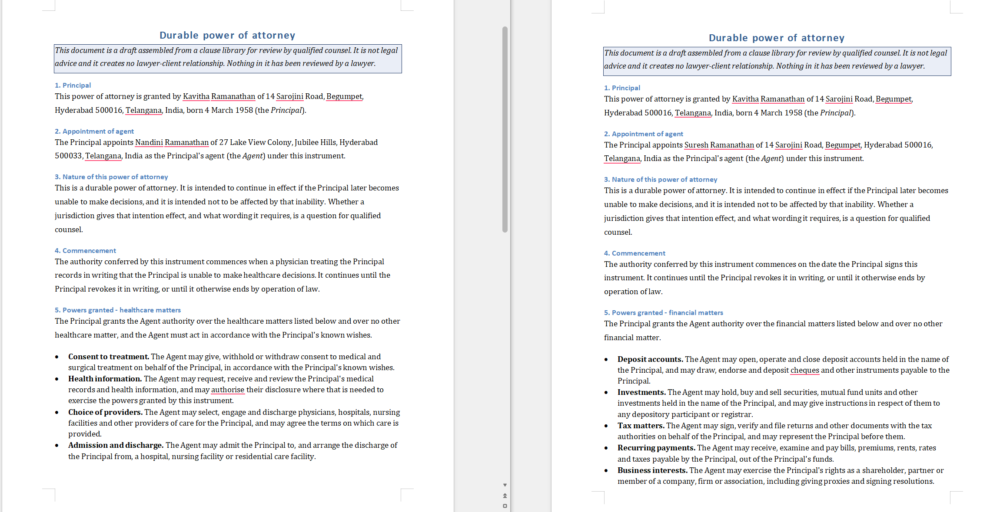

# Power-of-attorney generator

> **What strong looks like.** *Run the intake for a durable financial POA and a
> separate healthcare POA and confirm the two drafts differ correctly in granted
> powers, and both carry the review notice and the external-notarisation
> statement.*

That is the grading line, and [`scripts/verify_live_output.py`](scripts/verify_live_output.py)
is where it is checked — against the two **live** documents read back from the
API and against the two exported DOCX files, never against the run's own report.

---

## Two sentences on what this is

People assembling a power of attorney need the powers-granted language and the
general/limited/durable distinction to be right, and then they still have to get
the thing witnessed and notarised in person, which no product touches. This is a
guided intake that asks who the principal, agent and successor agent are, which
POA type applies and which specific powers are granted, assembles a clean draft
from a **data** clause library, and exports it — and it refuses to export at all
until it has read back, out of the live document, that both required notices are
present word for word.

**We are not lawyers.** [INVARIANTS.md](INVARIANTS.md) opens with the list of
things this system must never say, and that list was written before any code.

---

## Run it

```bash
make poa
```

Assembles both required drafts, prints the intake, the clause numbering, the
powers granted and withheld, the notice check and the edit plan, and writes both
renderings of each document to `var/poa/`. No API key, no network.

```bash
make poa-live
```

The same, driving SuperDocs. Six billable operations per draft. Reads
`SUPERDOCS_API_KEY` from `.env` only and never prints it.

```bash
python builds/poa-generator/scripts/verify_live_output.py <financial_doc_id> <healthcare_doc_id>
```

The grading line, re-checked from scratch.

---

## The one thing that is only possible because SuperDocs exists

A typeset power of attorney that survives six surgical edits with its layout
intact, is held at a per-item human gate on the way in, and comes out as a DOCX
with real Word table structure. Take SuperDocs out and what is left is a
string-templating script that emits HTML — the typeset rendering, the per-clause
targeted edits, the review gate and the export are all the product's.

Measured on the live run: 1 `w:tbl`, 4 rows, 16 cells, 16 bordered cells in each
exported DOCX, and both notices verbatim inside `word/document.xml`.

---

## How the parts divide, and why

| Who | Does what |
| --- | --- |
| The intake (ours) | Who the parties are, which POA type, which power ids |
| The library (data) | Every clause, power, POA type, jurisdiction, notice |
| The assembler (ours) | Which clauses apply, their numbers, every cross-reference, both renderings |
| SuperDocs | Holds the document, applies one chunk replacement at a time, gates each at a human approval, renders and exports |
| The verifier (ours) | Reads the whole document back after every edit and classifies what happened |
| The notice gate (ours) | Refuses the export unless both notices come back verbatim |

**We never ask SuperDocs to write a clause.** On 2026-08-09 we asked it for one
section and it produced six, four of them invented in confident,
domain-appropriate prose. In a power of attorney an invented clause is a power
nobody granted. So the powers are chosen in the intake and rendered by us, and a
fabricated power has no channel to arrive through — the defence is the absence
of a path, not a check on the output.

### The blank form is what gets uploaded

We compute the **entire** document for this intake — every clause that applies,
at its final number, with every cross-reference already pointing at the right
one, and both notices already in place — with the party names, the specific
powers, the limitation and the commencement left as blank-form markers. That is
uploaded verbatim (Decision 29). SuperDocs then only ever replaces the contents
of a chunk that already exists, which is the one operation measured to be
reliable. There is no insertion to perform, so the insertion bug cannot be
reached; there is no renumbering to delegate, so the renumber-around-a-missing-
insert failure cannot occur.

### Structure really is computed, and the two drafts prove it

The healthcare draft selects a clause the financial one does not
(`healthcare-records-access`, chosen by the condition
`category granted healthcare`), so every clause after it is numbered one higher:

```
durable-financial   ... 5. Powers granted - financial    6. Successor agent   7. Reliance ...
healthcare          ... 5. Powers granted - healthcare   6. Access to health information
                        7. Successor agent   8. Reliance ...
```

and the reliance clause's cross-reference moves with it — clause 6 in one draft,
clause 7 in the other. `test_the_shared_parts_really_are_shared` asserts the two
clauses are identical apart from exactly that digit.

---

## The clause library is data

Adding a jurisdiction or a power type is a **data edit**, and there is a test
that proves it by adding a row to a copy of `config/` and requiring the
behaviour to change with zero code edits.

| File | What it holds |
| --- | --- |
| `clause-library.csv` | Every clause: order, section, heading, tag, style, condition, body |
| `powers.csv` | The power catalogue, by category, with the granted-powers language |
| `poa-types.csv` | general / limited / durable, and whether a limitation is required |
| `jurisdictions.csv` | Governing-law and execution-requirement language |
| `notices.csv` | The two required notices, verbatim |
| `forbidden-phrases.csv` | What the draft may never say |
| `deferral-markers.txt` | What a jurisdiction row must contain to be accepted |
| `blank-form.csv` | What each gap says before the intake fills it |
| `signature-rows.csv`, `signature-table.csv` | The signature block |

`test_no_clause_text_is_hardcoded_anywhere_in_the_package` greps every `.py` in
`poa/` for every value in those files and fails on a hit.

The clause condition grammar is small and every part of it is evaluated, never
looked up:

```
condition := "always"
           | "type is" <type_id>
           | "type in" <type_id>|<type_id>
           | "category granted" <category>
```

An unparseable condition **raises**. It is never read as "this clause does not
apply" — a clause silently dropped out of a power of attorney has no symptom in
the finished document.

---

## The export gate

Hard constraint of this build, and it is structural rather than remembered:

- `PoaClient.export` requires a `NoticeReceipt`. There is no default argument.
- A `NoticeReceipt` can only be constructed by `check_notices()`, which takes a
  `ChunkMap` from a live read-back. Construct one directly and it raises.
- `check_notices()` makes two independent comparisons: the notice appears in the
  document's reader-visible text, **and** some single chunk's text *is* the
  notice, exactly. The first alone would pass a notice with a sentence inserted
  into the middle of it; the second alone would miss a second, contradicting
  copy.
- "Verbatim" is at the level of words, not bytes: whitespace and entity
  re-serialisation are forgiven, because a document editor is entitled to do
  both. One word changed, dropped or reordered is not.

The gate runs twice — once on the upload, before a single edit is issued, and
once on the final read-back, before anything is exported. Tests prove the
refusal for a **missing** notice, an **altered** notice, a **single word**
dropped, a notice **split across two chunks**, and a **sentence inserted** into
one.

The case that makes the gate worth having is the one the edit queue cannot
catch: every step verified applied, and the product reworded a notice on the way
past. From the queue's point of view that is a clean run. It is not one.
`test_a_reworded_notice_that_the_collateral_check_cannot_see_still_refuses_the_export`
drives exactly that: 6 of 6 applied, nothing halted, and no export.

---

## The failure path, exercised live

Every edit is: compute the expected post-state of the whole document → one
instruction, one chunk, on the async route → poll to the human gate → refuse
anything that is not exactly our change → write **our** decision row with a named
actor → approve → poll to completed → read the whole document back → classify.

Three classes, all detected: **not applied**, **applied wrong**, **collateral
damage**. On any of them the queue halts, no downstream step runs, the session is
reverted, the revert is read back and reported either way, and **no export is
produced**.

This is not only a test. On the live demo run of 2026-08-10 the financial draft
halted at step 1: the product returned the paragraph wrapped in a `<div>` nobody
asked for, twice — the first attempt and its one narrow retry. The run reported
`APPLIED WRONG` with the diff, refused to run steps 2 through 6, attempted the
revert, and reported honestly that the read-back did **not** match the last
verified-good state. No file was written. The same draft ran clean on the next
attempt, which is the shape of this product: the failure is intermittent, and
that is precisely why nothing is believed without a read-back.

---

## Tests

459 tests pass repo-wide with **no `.env` present and no network**, 113 of them
this app's. The SuperDocs failure classes are driven by recorded responses under
`docs/evidence/`, so they are the real shapes of failures the product really
produced.

Every guard added here was verified by **deliberately violating it** and watching
it go red — `make probe`, 101 of 101, 24 of them new.

```bash
make test    # ruff + corpus oracles + pytest, no key required
make probe   # break each guard on purpose and require it to notice
```

---

## What this build does not do

- It is not a UI. The intake is a JSON file, which is what the tests and the demo
  both drive — there is no second, easier path into the assembler.
- It does not revise a draft after the fact. The per-clause targeted revision
  loop the plan mentioned ("change the successor agent's name") is the same
  machinery pointed at an existing document; it is not built, and it is named
  here rather than implied.
- It does not say what any jurisdiction requires. Jurisdiction rows must defer to
  counsel, and a row that asserts a requirement is refused at load time.
- It never tells you the document is valid, executed or binding, because it is
  none of those things and this product cannot make it so.


---

## SuperDocs features used

- **Upload** (POST /v1/documents/upload-base64) - the fully assembled draft is uploaded verbatim; SuperDocs is never asked to create a clause.
- **Chat, async** (POST /v1/chat/async) - one targeted replace per request.
- **Review gate** (approval_mode: ask_every_time + POST /v1/chat/approve) - every change is gated.
- **Read-back** (GET /v1/documents/{id}?include_html=true) - after every edit the whole document is read back and compared to the post-state computed before sending.
- **Export** (POST /v1/documents/export) - gated: the .docx cannot be produced until read-back confirms both required notices are present verbatim.

## Environment

```
SUPERDOCS_API_KEY=your-key-here
SUPERDOCS_BASE_URL=https://api.superdocs.app
```

Tests run without a key against recorded fixtures. Only the live demo needs one.

## Output



Two live drafts are committed: [evidence/poa-durable-financial.docx](evidence/poa-durable-financial.docx) and [evidence/poa-healthcare.docx](evidence/poa-healthcare.docx). The granted powers differ correctly with no leakage either way; the healthcare draft carries an extra clause, so the successor-agent clause is 6 in one and 7 in the other, and the cross-reference that points at it moves with it. Both carry the counsel-review notice and the external-notarisation statement.

This is a drafting aid, not legal advice. Signing, witnessing and notarisation happen outside the product.

---

Built by **Preetham Kukkadapu** for the SuperDocs round 2 task.
