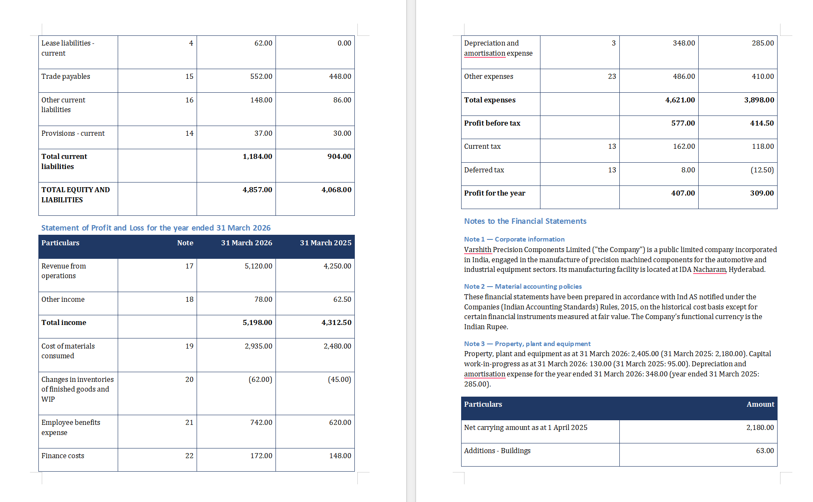

# Statutory financial statements builder

Rolls last year's signed statements forward to this year against the trial
balance and this year's event sources, and produces this year's statutory
accounts as an edited, typeset document: primary statements and comparatives
updated, each note's figures regenerated, notes whose required disclosures are
missing flagged **from the data**, and note numbering plus the disclosure
checklist consistent throughout.

## The grading line

> **Comparatives and the cross-references between notes and primary statements
> tie exactly; a newly required note is detected from the data rather than
> remembered by a human; note numbering and the checklist stay consistent after
> an insertion mid-document.**

Where each half is made true, and where to look:

| The claim | How it is true | Where |
| --- | --- | --- |
| Comparatives tie exactly | Every prior-year figure is cited **twice** — to the ledger's `fy2025` column and to the signed set — and a disagreement is a hard error, not a preference. Then every total the signed set prints is re-derived and compared. | `statements.py`, `tests/test_rollforward.py` |
| Note ↔ primary cross-references tie | The note's caption sentence and the statement row are the *same* `Figure` object, and the rendered HTML of both is re-scanned afterwards to prove it. | `bodies.py`, `skeleton.py::assert_note_captions_tie` |
| A new note is detected from the data | `account 1110 balance > 0` is true at 268.00 and its checklist items map to no note. Its **position** comes from the ledger's account order: the account before it points at Note 3, so the lease note is Note 4. Nothing in the code knows what a lease is. | `notetree.py`, `tests/test_note_tree.py` |
| Numbering stays consistent | One pass over our own ordered tree assigns every number; 22 notes shift; the renumbering must be order-preserving or the run stops. | `notetree.py::_validate` |
| The checklist stays consistent | Every `satisfied_by_note` is remapped through the **same** map, and afterwards every mapping is re-asserted against the headings **read back out of the document**. | `notetree.py::assert_checklist_consistent` |

## Run it

```bash
python -m statutory
```

No key, no network: the whole roll-forward, every tie, the note tree, the
checklist and the edit plan are computed offline and the report is printed.
The computed document is written in both shapes to `var/statutory/`.

```bash
python -m statutory --live --sample 4
```

Drives SuperDocs for the first four chunk replacements. `--live` with no
`--sample` does the whole plan; one billable operation per chunk.

Run from this directory (the folder name has a hyphen, so it is an application
folder rather than an import path; the importable package inside it is
`statutory`).

## What SuperDocs does, and why it has to exist

The deliverable is a **typeset** statutory document that survives dozens of
surgical edits with its layout intact and comes out as a DOCX an audit partner
signs. SuperDocs holds the document, applies each replacement inside its own
chunk model, holds every change at a human gate, and renders the export with
real Word table structure. Remove it and what is left is a DOCX manipulation
library — which is building a version *of* the product, the thing
[`builds/README.md`](../README.md) forbids.

`system/` cannot do this: it produces a grounded report and is not a document
editor. The boundary is enforced, not asserted — `tests/test_domain_boundary.py`.

## The design, and the measurements it came from

Every one of these was earned by testing the product, not chosen by preference
(PROGRESS.md, 2026-08-07 and 2026-08-09).

- **One verb, and it is `replace`** (Decision 28). We never ask SuperDocs to
  create. The only operation that inserts is also the one that appended six
  sections when asked for one, four of them invented.
- **The entire final skeleton is computed here and uploaded verbatim**
  (Decision 29) — every heading already at its final number, every
  cross-reference already repointed. **There is no mid-document insertion in
  this design**, so the failure cannot be reached. It is also the only path
  measured to preserve a styled document exactly.
- **The async route** (Decision 32), because `approve` takes a `job_id` and jobs
  exist only on `/v1/chat/async`.
- **Our ledger is the record; `approve` is an actuator** (Decision 33). The
  product's gate is write-only: `pending_changes` reported the same three
  undecided items before and after two decisions.
- **Never send feedback on a denial** (Decision 34). Feedback triggered a
  revision pass that proposed edits to two chunks nobody targeted, aimed at the
  section headings, and held the job for minutes with approved work unapplied.
- **One change per job** (Decision 35). Nothing applies until a batch settles,
  and a batch can spawn a follow-up batch; with a batch of one, batch atomicity
  equals item atomicity.
- **The verified unit is the chunk, not the value** (Decision 37). Measured:
  four cells in one table changed in one request with every style attribute
  byte-preserved, and every failure this project has recorded was *across*
  chunks. So the skeleton is chunk-aligned and a note schedule is one table.

## The failure path

Every step computes its expected post-state **before** sending, then reads the
whole document back and classifies:

- **NOT APPLIED** — the target chunk came back unchanged. Halt. No downstream
  step runs, because a downstream step is the consequence of work that may not
  have happened.
- **APPLIED WRONG** — it changed, but not to the computed post-state. Halt, show
  the diff.
- **COLLATERAL DAMAGE** — any non-target chunk moved, appeared or vanished.
  Halt, and never retry: the document already holds content nobody asked for.
  This is the dangerous one. In the append test the requested change *also*
  succeeded while four fabricated sections appeared, so a verifier checking only
  its own target would have reported success.

On any failure: revert to the last verified-good state, **read back again and
say whether the revert actually happened**, surface the diff, produce **no
export**. At most one narrow retry of the same instruction; never a re-plan.

The three classes are tested against the recorded responses in
`docs/evidence/2026-08-09-superdocs-reverify/` — the real shapes of the real
failures, replayed with no key and no network.

## What it will not do, and why that is the point

The supplied trial balance is at **caption granularity**: 29 accounts, one per
caption. So no breakdown finer than a caption is derivable, and roughly twenty
notes cannot state the analysis they stated last year. The build does not carry
last year's breakdown forward under this year's heading. Each note states the
tied total and names exactly what is outstanding and where we looked, and the
checklist marks those items `outstanding` rather than `satisfied`.

That is a deliberate cut and it is the honest one: a stale figure under a new
heading is the failure this whole project is about.

## Layout

```
statutory/          the package
  money.py          the figure recogniser, narrow in both directions
  figures.py        Cite / Figure / Derived / Quotient / Gap, and the Body guarantee
  csvspans.py       an RFC 4180 scanner that keeps byte positions
  ledger.py         the trial balance
  priorset.py       last year's signed statements, parsed with byte offsets
  checklist.py      32 rows of data and a grammar that evaluates them
  events.py         events detected from this year's sources, never remembered
  statements.py     the roll-forward, the comparatives, the ties
  notetree.py       insertion point, numbering, repointing, checklist remap
  bodies.py         note regeneration, six data-selected recipes, and the gaps
  skeleton.py       the whole document in both shapes
  chunks.py         the chunk model and the canonical form
  editplan.py       one single-target replacement per step
  superdocs/        transport, client, decision ledger, verifier
  orchestrator.py   upload once, then one verified replacement at a time
  report.py         what the run says for itself
config/             note recipes, event vocabulary, new-note titles, carry rules
tests/              the suite; runs with no key and no network
INVARIANTS.md       the "must never" list, each item naming the test that proves it
```


---

## SuperDocs features used

- **Upload** (POST /v1/documents/upload-base64) - the fully computed document skeleton is uploaded verbatim; every heading is already at its final number and every cross-reference already repointed.
- **Chat, async** (POST /v1/chat/async) - one targeted replace per request.
- **Review gate** (approval_mode: ask_every_time + POST /v1/chat/approve) - every change is gated.
- **Read-back** (GET /v1/documents/{id}?include_html=true) - after every edit the whole document is read back and compared to the post-state computed before sending, including every non-target chunk.
- **Export** (POST /v1/documents/export) - the final .docx.

## Environment

```
SUPERDOCS_API_KEY=your-key-here
SUPERDOCS_BASE_URL=https://api.superdocs.app
```

Tests run without a key against recorded fixtures. Only the live demo needs one.

## Output



A live run is committed at [evidence/statements.docx](evidence/statements.docx): 33 edits, each verified by read-back. Total assets and total equity and liabilities both come to 4,857.00, with FY2025 comparatives of 4,068.00. A warehouse lease commenced in the year, so a right-of-use asset appears and a lease note is created at position 4 - detected from the trial balance, not from a hardcoded list of standards - and the 22 notes after it renumber, with the note column in the primary statements and the disclosure checklist remapped through the same map.

---

Built by **Preetham Kukkadapu** for the SuperDocs round 2 task.
