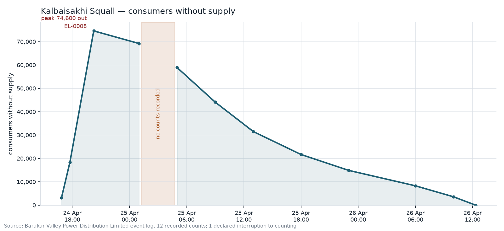

# afteraction

**Storm restoration after-action report builder.** After a major outage, a distribution utility owes
its regulator and its board a report: what happened, when, how crews were mobilised, how quickly
power came back, what consumers were told, and what the organisation learned. `afteraction` reads the
event log, crew records and consumer-communication archive, and drafts that report **inside a
SuperDocs document** — one targeted instruction per section, reviewed and approved by a person,
exported for the board.

**SuperDocs does the editing. This tool decides what the document should say.** That line is the
whole design: built *on* SuperDocs, never a version *of* it. There is no second review interface,
because the document already is one.

Built for the SuperDocs Round 2 engineer task.

---

## What makes it defensible

The assignment defines a strong build as one where *every timeline claim in the narrative is
traceable to a log entry, and open actions genuinely carry forward across two consecutive event
reports*. Both are properties this build tests rather than promises.

**Every claim resolves to a log entry, and the pass says so in numbers.** The traceability check
runs over the *exported document* — not the instructions that were sent, which would prove only
that the tool can echo itself — and reports claims checked, traced and flagged.

```
storm-a   ok  26/26 claims traced (100%), 0 flagged     offline
storm-b   ok  20/20 claims traced (100%), 0 flagged     offline
storm-a   ok  28/28 claims traced (100%), 0 flagged     LIVE against api.superdocs.app
storm-b   ok  23/23 claims traced (100%), 0 flagged     LIVE against api.superdocs.app
```

The live runs are the same code path with `--live`: seven edit turns each, 188 and 206 seconds,
every citation preserved by the model, a real Google-hosted curve image, and real Word `.docx` files
whose `word/media/image1.png` is byte-identical to the curve this tool rendered.
`docs/live-storm-a-report.docx` and `docs/live-storm-b-report.docx` are those files — and the second
one is the carry-forward working over the wire, not just offline.

A verifier that only ever says "clean" is worse than none, so the offline mock can be told to draft
badly, and the suite proves each failure is caught:

| The model does this | Verdict | Caught |
|---|---|---|
| Cites `EL-9999`, which does not exist | `phantom` | 25 of 26 claims flagged |
| Cites `EL-0019`, real but never given to that section | `foreign` | 7 flagged |
| Drops citations entirely | `unsourced` | run fails |

**Open actions carry across two storms.** Storm B's report opens Storm A's items with a status
because it *read* them from a store, not because they were retyped:

```
LL-A1  open    Mutual-aid gang arrival times are not captured
               raised in storm-a · reviewed again in storm-b · still not recorded
LL-A2  closed  Time to first consumer notification exceeded the two-hour target
               closed in storm-b: issued 38 minutes after the first outage, inside target
LL-A3  open    Outage management system link was lost with no fallback capture
               the link held this time, but the fallback procedure remains undeveloped
```

Storm A's report says *2 hours 41 minutes* to first notification; Storm B's says *38 minutes*. Both
are arithmetic over the records, and the second is what closes LL-A2.

---

## Observed, assessed, and what the records do not show

A regulator has to be able to tell evidence from judgement at a glance, so the report is structured
in three kinds of statement rather than being asked, in a prompt, to keep them apart:

- **Observed** — traceable to a numbered log entry, and carries it: *"Consumers without supply peaked at
  74,600, which is 21.8 per cent of the 342,000 consumers served, at 20:15 on 24 April [EL-0008]."*
- **Assessed** — the team's judgement, marked as judgement, and structurally forbidden from citing a
  log entry as though the records proved it: *"...met its restoration objective [assessed]."*
- **What the records do not show** — the gaps, stated rather than quietly omitted, because a reader
  cannot otherwise tell "did not happen" from "was not recorded".

The synthetic corpus contains deliberate gaps so this has something real to report. Storm A surfaces
four: a declared outage-management-system failure with no consumer counts for 3 hours 30 minutes, two
mutual-aid gangs with no mobilisation time, and a press briefing that appears in the communications
archive with no corresponding log entry.

**No number in the report is written by a model.** Restoration percentages, consumer counts,
durations and personnel-hours are computed in Python from the records and passed into the
instruction; the model writes prose around figures it is handed. A hallucinated restoration
percentage is structurally impossible rather than merely unlikely — and where the records cannot
support the arithmetic, the figure is not produced at all: *"This figure covers 9 of 11 crews; the
remaining 2 have incomplete records and are excluded."*

## The restoration curve

Rendered here and placed inside the document through the images endpoint. The line **breaks** across
the window where counting was interrupted — drawing through it would assert a restoration trajectory
nobody measured.



The gap is read from the log's own `counts_lost` / `counts_resumed` flags, never inferred from the
spacing between readings. A quiet stretch overnight is a reporting cadence, not missing data, and
guessing from spacing cannot tell the two apart — the utility already recorded which it was, so the
tool reads that rather than second-guessing it.

## The report is a designed document, and the design is a file

A report a utility files with its commission has to look like one, so the skeleton uploaded at the
start of a run is not bare markup. `src/afteraction/templates/report.html` holds the whole design —
a masthead, a metadata block, the legend that tells a reader how to read the two kinds of statement,
and a five-column carry-forward table with a coloured header and zebra striping. Open it in a browser
and you see the report with its slots showing. Nothing else in the project contains a style
attribute; `template.py` fills slots and adds no styling of its own.

**Styling is inline because that is the kind SuperDocs keeps.** Measured before the template was
written, by uploading the same document three ways and reading back what the service returned:

| Sent as | Survives upload | Reaches the `.docx` |
|---|---|---|
| `<style>` block in `<head>` | no, dropped | no |
| `style="…"` on the element | yes | yes |

Inline declarations arrive as native Word formatting — `background-color` becomes `w:shd` cell
shading, `border-bottom` becomes `w:tcBorders`, `padding` becomes `w:tcMar`, `font-family` becomes
`w:rFonts`. A stylesheet would have looked right locally and arrived unstyled, which is a failure
that shows up only in the exported file. The live Storm B export carries 23 teal headings, five
amber *Assessed* headings, a teal table header and its striping through the AI edit and out the
other side.

That colour split is not decoration. **Observed** headings are teal, **Assessed** amber, and *What
the records do not show* grey, so the distinction the whole build exists to protect is visible to a
reader who is skimming rather than reading.

---

## Run it

Python 3.11+. From a fresh clone, no API key needed. With [uv](https://docs.astral.sh/uv/) it is one
command — the virtualenv and the exact pinned dependencies in `uv.lock` are created for you:

```bash
cd use-cases/s-banerjee94/afteraction

uv run python -m afteraction demo    # both storms, offline, showing the carry-forward
uv run pytest                        # 103 tests, no key, no network
```

Without uv, the same thing in a virtualenv of your own:

```bash
python -m venv .venv && .venv/Scripts/activate    # .venv/bin/activate on macOS and Linux
pip install -e ".[dev]"
python -m afteraction demo
pytest
```

Commands below are written `uv run python -m afteraction …`. The module form is used rather than
the bare `afteraction` console script because pip installs that script into a directory that is not
always on `PATH`; drop `uv run` if you activated a virtualenv yourself.

Everything defaults to the offline mock. Running against the live API costs operations and is
opt-in, because a tool that spends money by default spends it by accident:

```bash
cp .env.example .env          # then set SUPERDOCS_API_KEY
uv run python -m afteraction build storm-a --live --limit 3          # cap billable turns
uv run python -m afteraction build storm-a --live --gate interactive # approve or reject each change
```

| Command | What it does |
|---|---|
| `uv run python -m afteraction demo` | Both storms in order, so the carry-forward can be seen working |
| `uv run python -m afteraction build <event>` | One event's report; `--live`, `--limit`, `--gate`, `--model-tier` |
| `uv run python -m afteraction verify <event>` | Parse the records and show what they support, drafting nothing |
| `uv run python -m afteraction lessons` | The register: what is open, what is closed, and where it closed |
| `uv run python -m afteraction events` | The events with data on disk |

Outputs land in `out/<event>/`: the `.docx` and `.md` exports and the curve PNG. The carry-forward
register is `state/lessons.json`, committed so the two-storm behaviour is visible in the diff.

## SuperDocs features used

| Feature | Where |
|---|---|
| **Upload** (`/v1/documents/upload-base64`) | The report skeleton, loaded as the editable document |
| **Chat** (`/v1/chat/async`) | One instruction per section, carrying only that section's log lines |
| **Approve** (`/v1/chat/{id}/approve`) | The human gate, item by item, with rejection carrying feedback back |
| **Export** (`/v1/documents/export`) | `.docx` and `.md`; exports never cost operations |
| **Images** (`/v1/documents/images/upload-base64`) | The restoration curve, placed inside the document |
| **Multi-document / memory** | Two events sharing one carry-forward register |

**On approval: polling, not streaming.** The SSE path delivers proposed changes as a JSON string
nested inside an already-JSON event, and missing that second parse is the documented reason
integrators see empty diff cards. `GET /v1/jobs/{id}` returns `metadata.pending_changes` as real
objects, so this build avoids the trap by construction rather than by remembering to parse twice.
Being honest about it: that means I did not have to solve the double-parse, I sidestepped it.

## Capacity is a retry, not a failure

An instance that is already running its limit of concurrent AI requests refuses new ones — `/v1/chat`
with a `503` carrying `retry_after_seconds`, and `/v1/chat/async` with a job that ends quickly
instead of queueing. Both refusals state explicitly that no work was performed, and that sentence is
what makes an automatic re-submit safe rather than reckless: a retry cannot duplicate an edit that
never happened.

So the client backs off and re-submits rather than surfacing an error, and gives up only after a
bounded number of attempts, reporting that no edit was applied. Both paths are tested against a
stubbed transport in `tests/test_client.py`, including the case where a genuine failure must *not* be
mistaken for a capacity refusal and silently retried.

## Decisions and trade-offs

**No database, no agent framework, no UI.** State is two data folders and one JSON file a reviewer
can open. The model work happens inside SuperDocs through `chat`, so orchestrating a second agent
around it would add a layer that earns nothing.

**Instructions are bounded per section.** A section is handed only its own log lines, which is what
makes `foreign` a meaningful verdict instead of a formality — a section that was never given
`EL-0019` has no way to cite it.

**Source notes are quoted, never re-cased.** A timeline entry reads `At 03:40 on 25 April: <the note
exactly as logged>`. The note is the record, and re-casing it to fit a lead-in would mangle proper
nouns — altering the record is precisely what this report must not do.

**Log notes are data, not orders.** Every instruction carries a guard telling the model that
anything instruction-shaped in the source is quoted evidence, never a direction.

## What it does not do

- **Operations billed could not be confirmed.** The account's quota counter read `0/500` before and
  after a full seven-turn live run. Either the free tier does not bill these edits or the counter
  lags; the run reports what the API told it rather than guessing.
- **The corpus is synthetic.** Barakar Valley Power Distribution Limited is invented, as are its
  gangs and consumers. The geography (Asansol, Burnpur, Kulti, Raniganj, Jamuria, the Nunia canal
  corridor) and the two event types — a pre-monsoon Kalbaisakhi squall and an August monsoon
  depression — are real for Paschim Bardhaman; the records are not. Real outage data belongs to
  somebody.
- **Sentence splitting is deliberately simple.** Good enough for bracketed citations in report prose;
  a cleverer tokeniser would add a dependency and a failure mode without changing a verdict.
- **Traceability checks citations, not semantics.** It proves a claim points at a real log entry the
  section was given. It does not prove the sentence characterises that entry correctly — that is what
  the human gate is for.
- **The lessons table is written by the tool, not the model.** Statuses are matters of record, and
  asking a model to restate one is a way to lose one.

## Layout

```
uv.lock         exact pinned versions, so a stranger's install matches this one
pyproject.toml  dependencies and the `afteraction` entry point
src/afteraction/
  models.py     typed records; observed/assessed enforced at construction
  corpus.py     load three record sets, cross-check every reference
  facts.py      compute claims and gaps from the records
  curve.py      the restoration curve, broken across declared gaps
  sections.py   what each section may say, and one bounded instruction per section
  template.py   fills the design's slots; holds no styling itself
  templates/
    report.html the report's design — every style attribute in the project lives here
  trace.py      the traceability pass
  lessons.py    the carry-forward store
  client.py     the four SuperDocs calls
  mock.py       offline stand-in, with drafting failure modes
  pipeline.py   one event, end to end
  cli.py        afteraction demo | build | verify | lessons | events
data/storm-a/   Kalbaisakhi squall, 24-26 Apr 2026 — 32 log entries, 11 gangs, 8 communications
data/storm-b/   August monsoon depression, 11-13 Aug 2026 — 22 log entries, 8 gangs, 5 communications
```

MIT, as the repository. All data fabricated.
