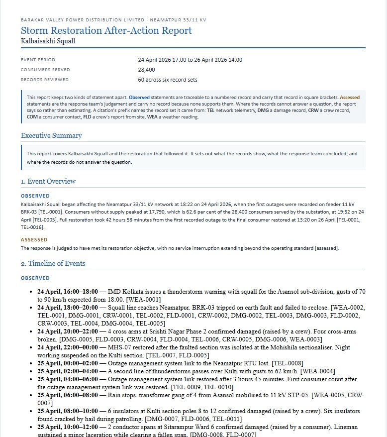
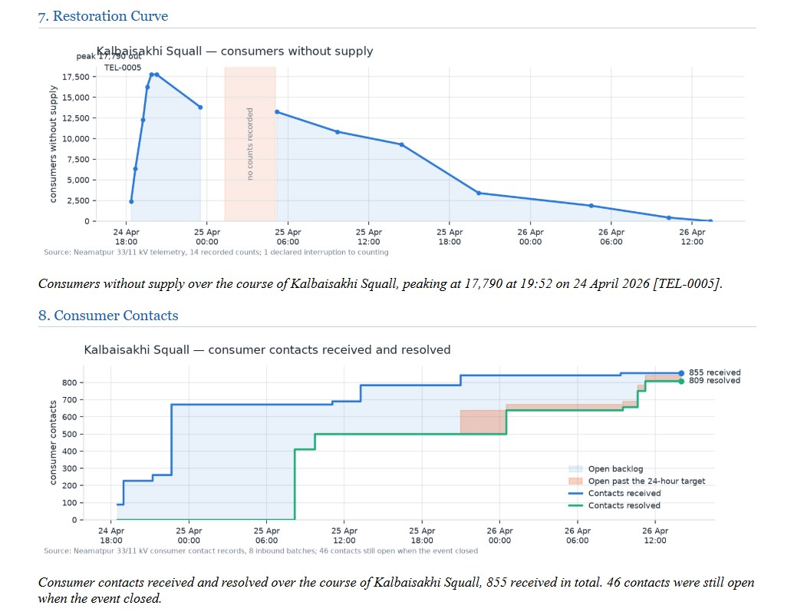
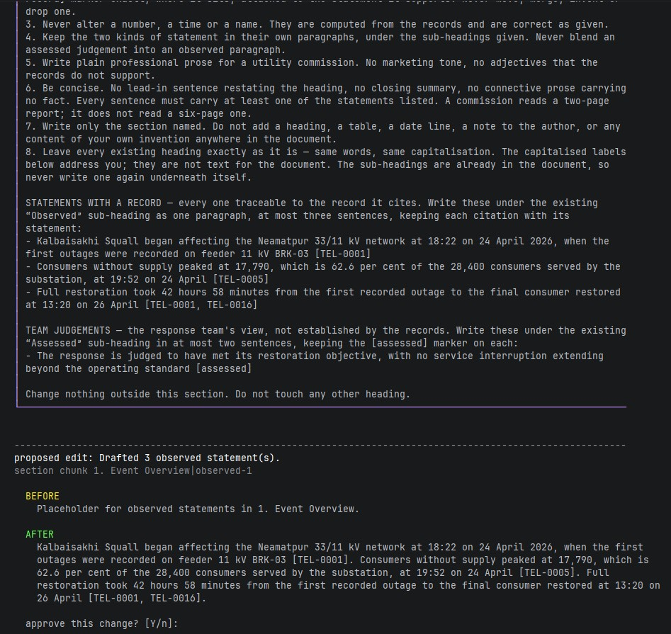

# afteraction

**Storm restoration after-action reports, drafted inside a SuperDocs document.**

After a big outage a utility owes its regulator a report: what happened, when, how crews responded, what customers were told, what will change. Someone writes it by hand from six piles of records, and it takes weeks. Every sentence in it can be challenged — so every sentence has to point at the record it came from.

`afteraction` reads the records, computes the figures, and has SuperDocs write the report around them. One instruction per section, approved by a person, exported for the board.

> **SuperDocs does the editing. This tool decides what the document should say.**
> Built *on* SuperDocs, not a version *of* it — no second review screen, because the document already is one.





*Both charts are rendered from the records, uploaded as images and placed **inside** the document. The pink band on the curve is a declared telemetry gap — the line breaks across it instead of guessing through it.*



*`--gate interactive`: nothing is written until a person says so. The instruction is printed above the change it produced, because approving an answer without seeing the question proves nothing — and a rejection carries a reason back to the model.*

---

## Quick start

No API key. No configuration. No network.

```bash
cd use-cases/s-banerjee94/afteraction

uv run python -m afteraction demo    # both storms, offline, a few seconds
uv run pytest                        # 163 tests
```

[uv](https://docs.astral.sh/uv/) builds the environment from `uv.lock` on first run.

**For a live run** — costs operations:

```bash
cp .env.example .env                 # then set SUPERDOCS_API_KEY=your-key-here
uv run python -m afteraction build storm-a --live --limit 2
```

---

## What it produces

Two storms, run in order. The second one **remembers** the first.

Offline (`demo`), which is what you get with no key:

```
storm-a   ok  37/37 claims traced (100%)   0 inherited, 4 raised here
storm-b   ok  26/26 claims traced (100%)   4 inherited (2 open, 2 closed), 1 raised here
```

Against the real API (`--live`), which is what `docs/live-storm-*` were built from:

```
storm-a   ok  38/38 claims traced (100%)   10 turns, every edit confined to its own section
storm-b   ok  28/28 claims traced (100%)   12 turns — 2 re-issued after an edit did not land
```

Storm B's two extra turns are the point, not a blemish. Two sections reported a successful
edit and left their placeholder standing. The check reads the exported document rather than
the reply, caught both, re-issued both, and they landed.

Output lands in `out/<event>/`: a Word `.docx`, a Markdown copy, both charts. Finished examples are committed in `docs/` so you can judge the output without running anything.

---

## The two things it is graded on

**1 · Every claim points at a real record.** Each sentence carries a citation like `[TEL-0005]`. A checker reads the **exported document** and resolves every one — checking the instructions we *sent* would prove nothing.

**2 · Lessons carry forward.** Storm B opens Storm A's items with a status because it read them:

| Item | Status | Why |
|---|---|---|
| LL-A1 | open | mutual-aid mobilisation times still not recorded |
| LL-A2 | **closed** | notification took 38 min, inside the two-hour target |
| LL-A3 | open | link held, but the fallback procedure is still missing |
| LL-A4 | **closed** | a gang inspected the pole a consumer reported; it is sound |

Storm A reported *2 h 13 min* to first notification, Storm B *38 min*. Both are arithmetic over the records, and the second is what closes LL-A2.

---

## How it works

```
six record sets  →  facts + figures (Python)  →  one instruction per section
                 →  SuperDocs: upload · chat · approve · export
                 →  lessons register  →  carried into the next event
```

- **Six record sets, not one log.** `WEA` weather · `TEL` telemetry · `DMG` damage · `CRW` crews · `COM` messages · `FLD` field reports. The prefix travels into the report, so `[TEL-0032]` reads as machine data and `[COM-0014]` as a phone call.
- **Numbers are never written by a model.** Percentages, counts and durations are computed in Python and handed over as correct. Reported damage is never added to confirmed damage.
- **The timeline scales with the storm, not with the log.** Over 16 hours → one bullet per 2 hours; at or under → one per hour. Storm A: 60 records → **17 bullets**. Storm B: 42 → **12**.
- **Python picks the window, SuperDocs writes the sentence.** A model choosing which twenty of two thousand records matter gives you a selection nobody can defend.
- **All windows go out in one request.** The API allows 25 targeted edits per operation, so the timeline costs **1** operation, not 17.
- **Three kinds of statement, kept apart** — Observed (traceable, carries its record), Assessed (judgement, marked as such), and what the records do not show. Enforced when the object is built, not asked for in a prompt.
- **The executive summary is written last**, from the finished document rather than from a second copy of the facts.

Design reasoning and every decision that turned out wrong is in **[PLAN.md](PLAN.md)**.

---

## Four checks that can fail a run

Each has caught a real defect on a live run.

| Check | Catches |
|---|---|
| **Traceability** | a citation that does not resolve |
| **Shape** | an invented heading, or a placeholder an edit never replaced |
| **Surgical** | an edit that changed a section it was not aimed at |
| **Retry** | an edit that reported success and did nothing — re-issued once, then reported |

A verifier that only ever says "clean" is worse than none, so the mock can be told to misbehave and the tests prove each failure is caught.

---

## SuperDocs features used

| Feature | Endpoint | Used for |
|---|---|---|
| **Upload** | `/v1/documents/upload-base64` | the styled report skeleton |
| **Chat** | `/v1/chat/async` | one instruction per section |
| **Approve** | `/v1/chat/{id}/approve` | the human gate, change by change |
| **Export** | `/v1/documents/export` | `.docx` and `.md` — never costs operations |
| **Images** | `/v1/documents/images/upload-base64` | the restoration curve and the contacts chart |
| **Memory** | — | two events sharing one register |

- **Polling, not streaming.** The SSE path nests proposed changes as a JSON string inside a JSON event; missing that second parse is the documented reason integrators see empty diff cards. Polling `GET /v1/jobs/{id}` returns real objects. Being honest: I *avoided* the double-parse rather than solving it.
- **A `503` is a retry, not a failure.** A busy instance states *"No work was performed"* — that sentence is what makes an automatic retry safe.

---

## Commands

Five commands. Everything is offline unless you pass `--live`.

| Command | What it does | Costs money? |
|---|---|---|
| `demo` | Runs every event in `data/` in order, from a cleared register, so you can see the carry-forward work | no |
| `build <event>` | Drafts one event's report | only with `--live` |
| `verify <event>` | Reads the records and prints what they support. Drafts nothing, calls nothing | no |
| `lessons` | Shows the register: what is open, what is closed, and which event raised it | no |
| `events` | Lists the events with data on disk, oldest first | no |

```bash
uv run python -m afteraction demo
uv run python -m afteraction build storm-a
uv run python -m afteraction verify storm-a
uv run python -m afteraction lessons
uv run python -m afteraction events
```

Every command takes `--help`.

### Flags

**`build <event>`**

| Flag | What it does |
|---|---|
| *(none)* | offline mock — free, instant, the default |
| `--live` | use the real SuperDocs API. **Costs operations** |
| `--limit N` | stop after N edits. Use this on a first live run |
| `--gate interactive` | **you** approve or reject each change, with a reason |
| `--gate reject-all` | refuse everything, to prove rejection really works |
| `--gate approve-all` | approve everything (the default) |
| `--prompts` / `--no-prompts` | print each instruction before the change it produces. On by default with `--gate interactive` |
| `--model-tier` | `core` (default), `turbo`, `pro`, `max` |
| `--store PATH` | which carry-forward register to use. Default is `state/lessons.json` |
| `--out PATH` | where to write the report. Default is `out/<event>/` |

**`demo`** takes `--live`, `--prompts`, and `--store` (default `out/demo-lessons.json`).
**`lessons`** takes `--store`. **`verify`** and **`events`** take no flags.

### How do I…

**…see it work, without an API key**

```bash
uv run python -m afteraction demo
```

Both storms, a few seconds, and the second report opens the first one's lessons.

**…see what the records support before anything is drafted**

```bash
uv run python -m afteraction verify storm-a
```

Prints every Observed statement with its citation, every Assessed judgement, and every gap. Nothing is sent anywhere.

**…do my first live run without spending much**

```bash
cp .env.example .env      # then set SUPERDOCS_API_KEY=your-key-here
uv run python -m afteraction build storm-a --live --limit 1 --store out/scratch.json
```

One edit, one operation. Proves upload → chat → approve → export end to end.

**…approve the changes myself**

```bash
uv run python -m afteraction build storm-a --gate interactive
```

Each change is shown in full, before and after. Press Enter to approve, `n` to reject and type a reason. A full storm-a is 19 prompts, so add `--limit 2` while you get the feel of it.

**…see the instructions being sent**

```bash
uv run python -m afteraction build storm-a --prompts
```

Prints each instruction in full, then the change it produced.

**…prove that rejecting actually works**

```bash
uv run python -m afteraction build storm-a --gate reject-all
```

Refuses every change and reports the run as incomplete rather than pretending.

**…refresh both live reports properly**

```bash
rm state/lessons.json
uv run python -m afteraction build storm-a --live      # ~10 operations
uv run python -m afteraction build storm-b --live      # ~10 operations
uv run python -m afteraction lessons
```

Run them in this order. Storm B reads Storm A's register, so out of order it will fail with a carry-forward error.

**…add a new storm**

Drop a folder into `data/` with an `event.json` and the six record files. Every command picks it up. Events are ordered by their start date, never by folder name.

> **One thing worth knowing.** `state/lessons.json` is committed to the repository. Any `build` without `--store` rewrites it, so a half-finished or capped run leaves a half-finished register in your working tree. Point `--store` at something in `out/` (which is gitignored) for anything you are only experimenting with, and let the real register be written only by a clean full run.

**Offline is the default everywhere.** A tool that spends money by default spends it by accident.

---

## Limits, honestly

- **Traceability checks citations, not meaning.** It proves a claim points at a real record the section was given — not that the sentence describes it correctly. That is what the human gate is for.
- **Operations billed could not be confirmed.** The quota counter read `0/500` before and after full live runs. The tool reports what the API told it.
- **The committed live reports are stale.** `docs/live-storm-*.docx` and the screenshots predate the six-record rebuild. They show the pipeline working end to end against the real API; they do not show the current record structure. A live re-run is outstanding.
- **All data is invented.** Barakar Valley Power Distribution Limited, its crews and its customers are fictional. The geography around Asansol is real; the records are not.
- **No database, no UI, no agent framework.** State is two data folders and one JSON file you can read in the diff.

---

## Layout

```
data/storm-a/  data/storm-b/     six record sets each, plus lessons and event.json
state/lessons.json               the carry-forward register, committed so you can see it work
docs/                            finished reports, to judge the output without running anything

src/afteraction/
  models.py corpus.py facts.py   records in, facts and figures out
  windows.py                     the time-window rule
  curve.py                       both charts; the curve breaks across declared gaps
  sections.py template.py        what each section may say, and its instruction
  trace.py surgical.py           traceability, document shape, per-section proof
  lessons.py                     the carry-forward store
  client.py mock.py              the four SuperDocs calls, and an offline stand-in
  pipeline.py cli.py             one event end to end; demo | build | verify | lessons
```

---

Built for the **SuperDocs Round 2 engineer task**. MIT, as the repository. All data fabricated.
