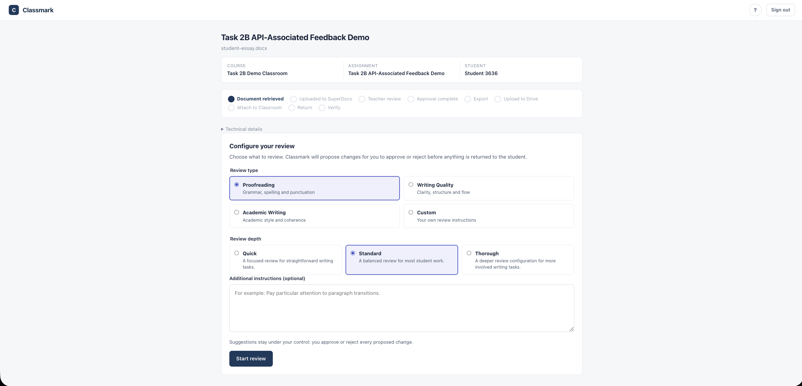
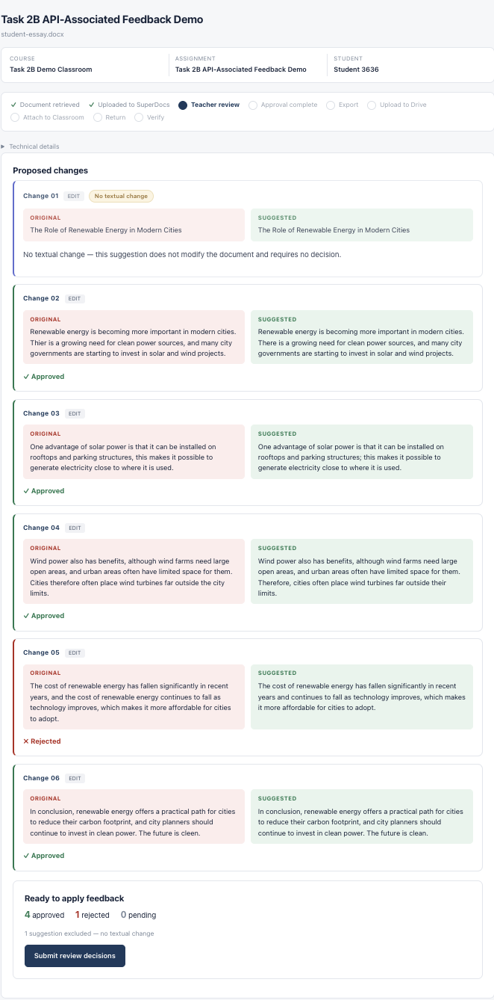
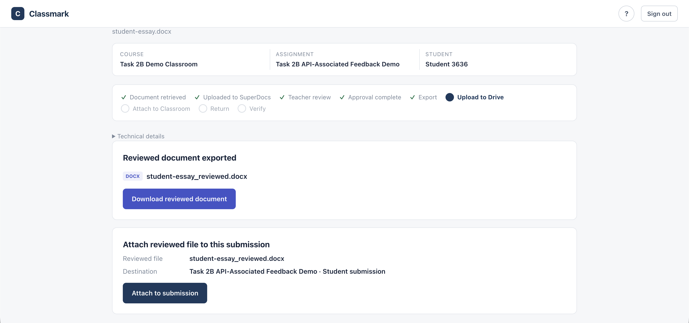
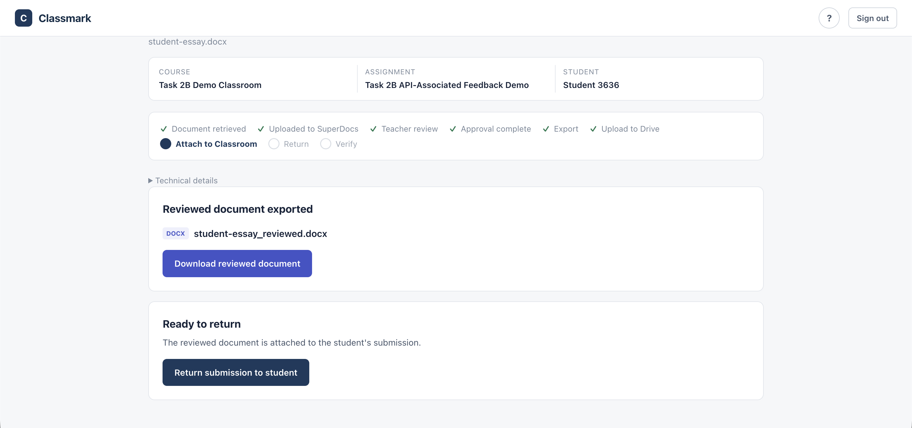
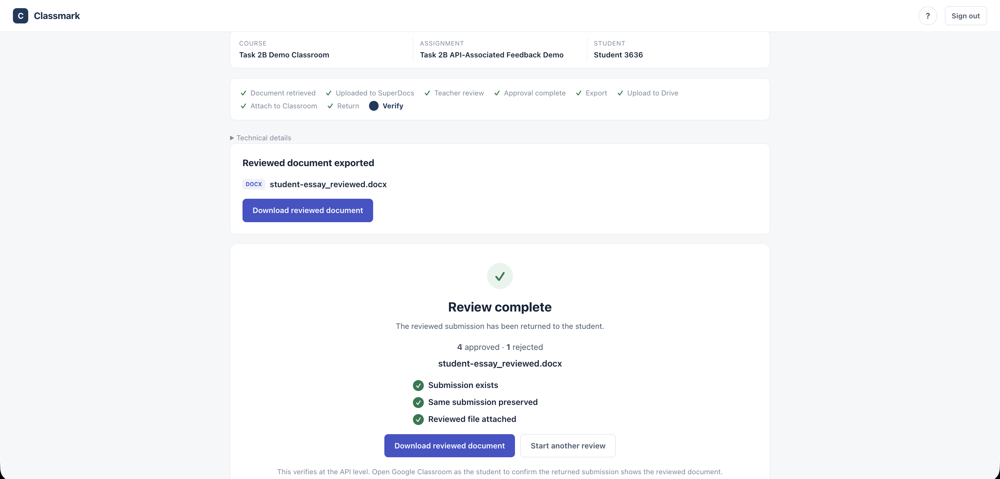
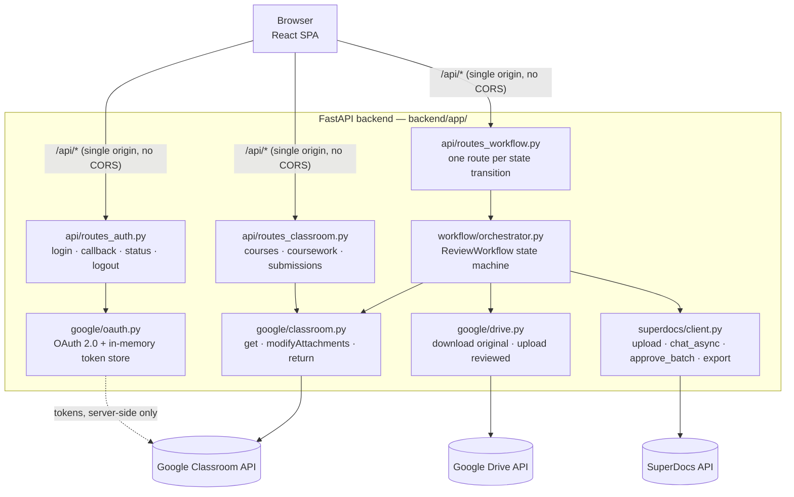
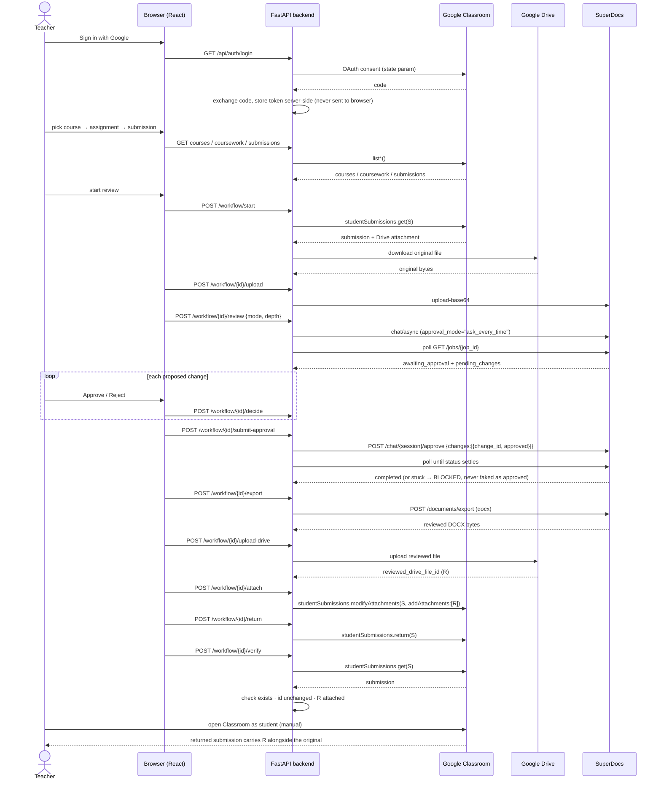

# Classmark — AI-assisted document feedback for Google Classroom

A teacher-facing web app that takes a real Google Classroom student submission,
runs it through SuperDocs' review engine with a mandatory human-in-the-loop
approval step, exports the reviewed document, attaches it back to **the same
Classroom submission** via `studentSubmissions.modifyAttachments`, returns the
submission, and verifies the result.

Task 2B of the SuperDocs Full-Stack AI Engineer assignment. Self-contained —
nothing here imports from the author's other task builds
projects; both stay untouched.

Built as a demonstration of the real integration loop, not a production LMS.

Built by **Sidharth CS** for the SuperDocs Full-Stack AI Engineer task.

**SuperDocs features used:** document upload (`upload-base64`), async review
(`chat/async`) with native `ask_every_time` human-in-the-loop, batch approval
(`change_id` contract), and export (`documents/export`, DOCX).

## Screenshots — a real submission through the full loop

| | |
|---|---|
| **1. Configure the review** | **2. Teacher review (native HITL)** |
|  |  |
| **3. Export + upload to Drive** | **4. Attach + return to student** |
|  |  |
| **5. Post-return verification — all three checks pass** | |
|  | |

Real run: 6 proposed changes, 1 correctly flagged as a no-op and excluded from
the count, 4 approved, 1 rejected — `4 approved · 1 rejected` carried through
to the final screen, all three post-return checks green.

---

## 1. What it solves

Grading a student's uploaded document today means leaving Google Classroom,
opening the file, marking it up in another tool, and reattaching it manually.
This app keeps the feedback inside the assignment workflow: the teacher stays
in one screen while the reviewed file is attached and returned to the student
by the same submission the student turned in.

## 2. Who it serves

EdTech teachers grading student submissions — anyone whose students upload
documents to Google Classroom.

## 3. Architecture





## 4. Workflow diagram

```
Sign in with Google
  → select course
    → select assignment
      → select student submission
        → download attached Drive file
        → upload to SuperDocs
        → send review instruction (approval_mode="ask_every_time")
        → show pending changes to the teacher
        → teacher approves / rejects every change          ← HUMAN-IN-THE-LOOP
        → submit decisions via SuperDocs approve endpoint
        → job reaches "completed" (native approval)
        → export reviewed DOCX
        → upload reviewed file to Drive
        → modifyAttachments on THE SAME submission
        → studentSubmissions.return
        → re-read submission → verify reviewed file attached
```

## 5. Google Classroom integration

| Step | API call |
|---|---|
| List courses | `GET /v1/courses` |
| List assignments | `GET /v1/courses/{courseId}/courseWork` |
| List submissions | `GET /v1/courses/{courseId}/courseWork/{id}/studentSubmissions` |
| Read submission | `GET /v1/courses/{courseId}/courseWork/{id}/studentSubmissions/{sid}` |
| Attach reviewed file | `POST .../studentSubmissions/{sid}:modifyAttachments` |
| Return submission | `POST .../studentSubmissions/{sid}:return` |

Official reference: https://developers.google.com/classroom/reference/rest

Identity is carried by IDs only: `course_id`, `coursework_id`,
`submission_id` are captured once from the teacher's selections and passed
verbatim to every call. The app never finds a submission by filename, never
substitutes another submission, and refuses (`_guard_identity`) any request
that would operate on a different one.

## 6. SuperDocs integration

| Step | Endpoint |
|---|---|
| Upload document | `POST /v1/documents/upload-base64` (`file_base64` — the live wire field) |
| Send review | `POST /v1/chat/async` with `approval_mode: "ask_every_time"` |
| Poll job | `GET /v1/jobs/{job_id}` |
| Approve (current official schema) | `POST /v1/chat/{session_id}/approve` `{job_id, approved, changes: [{change_id, approved}]}` — nested identifier is `change_id`, **not** `chunk_id` (live-verified: they always differ; chunk_id-shaped payloads never advanced the job) |
| Export | `POST /v1/documents/export` (`format: "docx"`) |

Official reference: https://docs.superdocs.app

### Teacher review configuration

Before a native HITL review begins, the teacher selects a review type and
depth. The browser sends only semantic choices; the backend validates and
maps them on the one existing `POST /v1/chat/async` request. Raw SuperDocs
model names are never exposed in the UI or accepted from the browser.

| Review type | Focus |
|---|---|
| Proofreading (default) | Grammar, spelling, punctuation, usage, and obvious mechanical errors |
| Writing Quality | Clarity, sentence structure, repetition, transitions, and flow |
| Academic Writing | Academic clarity, coherence, organization, transitions, and appropriate formal style |
| Custom | Teacher-defined focus, bounded by the same data-integrity and teacher-approval safeguards |

| Teacher depth | Server-side SuperDocs configuration |
|---|---|
| Quick | `core` + `fast` |
| Standard (default) | `core` + `balanced` |
| Thorough | `pro` + `deep` |

Every generated instruction keeps the replacement-only rule (no
`Original:`, `Corrected:`, `Changes made:`, or `List of changes:` labels),
preserves student voice, meaning, factual content, and original argument, and
does not introduce new claims. The original native `ask_every_time` approval
flow remains mandatory for every review type and depth.

## 7. OAuth setup

1. Google Cloud Console → enable **Google Classroom API** and **Google Drive API**.
2. **OAuth consent screen** — External, add your test teacher + test student as
   test users. The scopes below are sensitive; test-user mode (< 100 users)
   needs no app verification.
3. **Credentials → Create OAuth 2.0 Client ID** → Web application. Authorized
   redirect URI: `http://localhost:8020/api/auth/callback` (exactly).
4. Copy `GOOGLE_CLIENT_ID` / `GOOGLE_CLIENT_SECRET` into `.env`.

Required scopes:

```
https://www.googleapis.com/auth/classroom.courses.readonly
https://www.googleapis.com/auth/classroom.coursework.students.readonly
https://www.googleapis.com/auth/classroom.coursework.students
https://www.googleapis.com/auth/drive.readonly
https://www.googleapis.com/auth/drive.file
```

The flow is the standard authorization-code grant with `access_type=offline`
(so a refresh token is issued), a CSRF `state` parameter, and server-side
token storage. Tokens never reach the browser.

## 8. Environment variables

See `.env.example`:

```
GOOGLE_CLIENT_ID=        Google Cloud Console → Credentials → OAuth 2.0 Client ID
GOOGLE_CLIENT_SECRET=    same page
GOOGLE_REDIRECT_URI=     http://localhost:8020/api/auth/callback
SUPERDOCS_API_KEY=       docs.superdocs.app → POST /v1/users/me/api-keys
SUPERDOCS_BASE_URL=      https://api.superdocs.app
SESSION_SECRET=          python -c "import secrets; print(secrets.token_hex(32))"
PUBLIC_BASE_URL=         http://localhost:8020
LOG_LEVEL=               INFO
```

`.env` is gitignored. Never commit real credentials.

## 9. Local setup

```bash
make setup        # venv + pip deps + frontend build
cp .env.example .env   # fill in credentials
make dev          # backend on :8020, serves the built frontend at /
```

Pure frontend iteration: `make frontend-dev` (Vite on :5173, proxies /api).

## 10. How to run

```bash
make dev
# open http://localhost:8020
```

## 11. Unit + integration tests

```bash
make test         # backend pytest suite (no network, no credentials)
cd frontend && npm test   # frontend node:test suite (no deps beyond node)
```

Tests cover: SuperDocs request/response shaping (both approval shapes),
Classroom/Drive client construction, OAuth URL + token refresh, the workflow
state machine, the HITL gates (pending blocks export; blocked approval
blocks export), and the same-submission identity invariant (reviewed file R
attached to submission S, verified by re-reading S).

## 12. Live integration test

```bash
make smoke        # exercises the real SuperDocs HITL contract
# --with-google-auth additionally exercises the OAuth token exchange
```

The smoke script uploads a small document, sends a review instruction with
`ask_every_time`, polls for pending changes, approves them via the
documented batch endpoint, and requires the job to reach `completed` before
exporting. It exits non-zero and reports BLOCKED if the native approval does
not advance the job — it never falls back to auto-mode or corrective edits.

A full live Classroom loop (real course → real submission → real student
account) requires the test environment below and is the manual demo in
section 24.

## 13. Creating the test Classroom

1. As the **teacher** account: classroom.google.com → create a course
   (e.g. "Task 2B Feedback Demo").
2. Add the **student** account as a student of that course (invite by email).
3. Create an assignment titled **"Task 2B Feedback Demo"** (choose "Students
   can view or edit — file upload" if you want them to attach a document).
4. Both accounts must be test users on the OAuth consent screen, and the
   teacher must be the one signing into the app.

## 14. Creating the synthetic student submission

`demo/student-essay.docx` is a synthetic essay with deliberate, harmless
issues (a misspelling, a run-on sentence, a comma splice, a repetitive
sentence, a typo) so a review produces visible, sentence-level suggestions.
It is fabricated for this demo — not a real student's work.

As the **student** account: open the assignment → add the file → **Turn in**.

## 15. How the HITL review works

1. The review instruction is sent with `approval_mode="ask_every_time"`, so
   SuperDocs pauses the job at `awaiting_approval` instead of committing.
2. `GET /v1/jobs/{job_id}` returns `metadata.pending_changes` — each proposed
   edit with a chunk id and before/after HTML.
3. The teacher sees every change and must explicitly **Approve** or
   **Reject** it. Nothing advances until all changes are decided.
4. The teacher's decisions are submitted through the SuperDocs approval
   endpoint using the current production contract — the documented batch
   shape `{job_id, approved, changes: [{change_id, approved}]}`, where the
   nested identifier is `change_id` (not `chunk_id`). This is the single
   approval path; there is no per-chunk fallback.
5. The job must reach `completed`. Export is only allowed from
   `APPROVAL_COMPLETE` — a state that requires the native approval to have
   genuinely advanced the job.

## 16. What "approved" means technically

`APPROVAL_COMPLETE` in the workflow state machine. It is reached only when,
after the teacher's decisions were submitted through the approve endpoint,
polling shows the job `status == "completed"`. "Approved" never means "the
teacher clicked a local button"; the teacher's decision must land in
SuperDocs and the SuperDocs job must apply it.

## 17. How export works

`POST /v1/documents/export` with `format: "docx"` on the same SuperDocs
session. The binary response is the reviewed document — the student's
original with the approved review applied through the SuperDocs workflow.
`X-Export-Warnings` (if any) are surfaced in the workflow timeline.

## 18. How modifyAttachments works

`POST .../studentSubmissions/{submission_id}:modifyAttachments` with
`{"addAttachments": [{"driveFile": {"id": <reviewed_drive_file_id>}}]}`.
The reviewed file is **added** to the submission's existing attachments. The
submission id is the exact one the teacher selected — never a different
submission, never a new submission.

## 19. How return works

`POST .../studentSubmissions/{submission_id}:return` — only after the
attachment was verified attached. The returned submission carries the
reviewed file back to the student.

## 19b. Downloading the reviewed document

Once export genuinely completed (state `exported` or later), the UI shows a
**Download reviewed document** link backed by:

```
GET /api/workflow/{workflow_id}/export/download
```

The endpoint:
- requires an authenticated session,
- checks the session owns the workflow (one session cannot download another
  workflow's artifact — `owner_session_id` is bound at workflow creation),
- returns the **exact bytes SuperDocs exported** (the stored
  `_export_bytes` artifact — never regenerated, never the original file),
- is unavailable (HTTP 409) before export, while approval is pending or
  blocked, or if export failed.

The download is a real DOCX with a clear filename (e.g.
`student-essay_reviewed.docx`).

## 20. How post-return verification works

The app re-reads the submission (`studentSubmissions.get`) and checks three
facts:

```
submission_exists        the submission is still there
submission_id_unchanged  the id is exactly the selected one
reviewed_file_attached   the reviewed Drive file id is in its attachments
```

All three must pass; otherwise the workflow ends in ERROR with the failing
checks shown. The UI distinguishes **API-level verification** (what the
backend proved) from **browser-level confirmation** (open Classroom as the
student and see the returned submission — the app says so explicitly).

## 21. Security notes

- Credentials live only in `.env` (gitignored); `.env.example` is committed.
- Google tokens are stored server-side in memory, keyed by a signed session
  cookie (`HttpOnly`, `SameSite=Lax`). Never exposed to the browser.
- `state` parameter guards the OAuth callback against CSRF.
- The OAuth callback validates the state and exchanges the code server-side.
- No secrets in source control; no downloaded student documents committed.

## 21a. Suggested-text integrity (live-traced finding)

Live testing (2026-08) established where "Original: ... -> Corrected: ..."
annotations came from: the **review instruction itself**. The earlier
wording — "propose the change showing the original text and the corrected
text" — induced SuperDocs to append "Changes made: Original: X ->
Corrected: Y" inside the proposed replacement (`new_html`). The current
instruction explicitly demands replacement-only content (no labels, no
"Changes made:"/"List of changes:", no commentary). Three fresh real runs
with the current instruction produced **zero annotations** in any full
`new_html`.

The pipeline passes `new_html` through **verbatim** — no regex cleanup,
no reconstruction, no sanitizer (a previous sanitizer caused real
corruption and was removed). If the engine ever emits annotation text
again, it passes through faithfully; the parser never guesses the intended
text. No-op proposals (identical original/suggested text, e.g. an
unchanged heading) are classified by value comparison, stay visible for
transparency, and are excluded from decisions, counts, and the approval
payload.

## 21b. Optional student comments — capability-gated, deferred

An "optional message to the student" feature was considered. Investigation
of the official Google Classroom REST API v1 (`courses.courseWork.
studentSubmissions`) shows **no endpoint for private teacher comments on
submissions** — the only methods are get, list, modifyAttachments, patch,
reclaim, return, turnIn. Creating a comment through any other channel
(e.g. a Drive comment, a local record) would not be a genuine Classroom
comment. The feature is therefore **deferred, not faked**; the main
workflow does not depend on it.

## 22. Privacy / demo-data notes

The only document in this repo is `demo/student-essay.docx`, a synthetic
essay written for this task. It is not a real student's work, and the README
of the assignment explicitly allows own/public/synthetic documents. Do not
use confidential employer material or private third-party documents for the
demo. Review happens on documents the teacher selects from their own
Classroom.

## 23. Known limitations

- **SuperDocs native approval — resolved (2026-08)**. Earlier live runs
  showed approval never advancing the job; the root cause was **our wrong
  identifier**: the current official schema (`docs.superdocs.app/guides/
  integration-starter-prompt`) requires `change_id` inside `changes[]`,
  and live pending changes always carry a `change_id` distinct from
  `chunk_id`. Sending `chunk_id` (or the old per-chunk `{job_id, approved,
  chunk_id}` shape) was accepted but never consumed. With the documented
  `{job_id, approved, changes: [{change_id, approved}]}` shape, the live
  job transitions `awaiting_approval -> completed` (`batch_complete: true`).
  The workflow still **requires `completed`** before export — a stuck job
  enters BLOCKED honestly. `make smoke` re-tests the contract live. The
  full end-to-end loop was subsequently executed and verified (§27c).
- **Live updates**: the UI polls `/api/workflow/{id}/state` after each step
  instead of an SSE stream. Adequate for a click-through wizard; an SSE
  route is the upgrade path if multi-tab live updates are ever needed.
- **Refresh idempotency**: the active `workflow_id` is kept in
  `localStorage`, so a page refresh resumes the same workflow instead of
  starting a duplicate review of the same submission. A deliberate second
  run on the same submission (after "Start a new review") adds another
  reviewed attachment — the UI shows the reviewed file id so the teacher
  sees what is being attached.
- **Server restart**: the in-memory registry is cleared on restart. The UI
  detects this honestly — a resume attempt that 404s shows "This workflow
  expired after the server restarted. Start a new review." instead of
  pretending the workflow is still live.
- In-memory state: a backend restart clears auth tokens and in-progress
  workflows (teacher re-authenticates). Same decision the author's other builds
  make.
- The submission picker lists all submissions; the app requires a Drive
  file attachment and fails honestly otherwise (e.g. a `link` or
  `youTubeVideo` attachment).
- Native Google Doc attachments are exported to HTML before upload to
  SuperDocs (a plain `alt=media` download returns nothing for them).
- If the submission's document is not HTML-compatible, SuperDocs conversion
  behavior governs fidelity.
- `demo/student-essay.docx` is DOCX; SuperDocs returns HTML internally and
  exports DOCX — formatting fidelity is as good as SuperDocs' round-trip.

## 24. End-to-end demo instructions

Prerequisites: test teacher + test student, a course, the "Task 2B Feedback
Demo" assignment, `demo/student-essay.docx` submitted by the student, and
`.env` filled in.

1. `make dev`, open `http://localhost:8020`.
2. **Sign in with Google** (teacher account) — consent screen confirms the
   scopes.
3. Select the course → the assignment → the student's submission. The
   overview shows the original filename and submission id.
4. **Upload to SuperDocs & start review** — the original Drive file is
   downloaded, uploaded, and the review instruction is sent with
   `ask_every_time`.
5. The review screen lists SuperDocs' pending changes (before/after).
   Approve the good suggestions; **reject at least one** so the demo proves
   genuine HITL, not rubber-stamping.
6. **Submit review decisions to SuperDocs** — the app submits the decisions
   and polls; the job must reach `completed`.
7. **Export reviewed document** → **Upload reviewed file to Google Drive** →
   **Attach to this Classroom submission** (shows the exact submission id
   being modified) → **Return submission to student**.
8. **Verify post-return state** — the app re-reads the submission and shows
   the three checks with the reviewed file id.
9. Open Google Classroom **as the student**, open the returned assignment:
   the reviewed document is attached to the returned submission. Download
   it and confirm the approved changes are present and the rejected change
   is not.

## 25. Evidence / screenshots to capture

- Each workflow step in the UI (identity panel, review screen with mixed
  approve/reject, blocked state if hit).
- The verification screen with the three checks.
- Classroom as student: returned submission with the reviewed attachment.
- The downloaded reviewed document showing the approved edit applied.

## 26. Architecture decisions

| Decision | Why |
|---|---|
| Native HITL only, BLOCKED instead of fallback | The task's acceptance criterion is a real track-changes review with human approval. A local approve-button that doesn't drive SuperDocs would be fake. |
| Per-step API routes, guarded transitions | Every step's preconditions are enforced by the orchestrator; a failed step stops the chain honestly. |
| Identity by stored IDs, guarded | Same-submission correctness is the core invariant; nothing is inferred from filenames. |
| In-memory workflow registry | Matches the repo's established pattern; stated limitation. |
| Batch approval via the `change_id` contract | The current official schema `{job_id, approved, changes: [{change_id, approved}]}` — live-verified to advance `awaiting_approval -> completed`. The old per-chunk shape is not used; a stuck job enters BLOCKED honestly. |
| Single origin, no CORS | Consistent with the author's other task builds. |

## 27. API references

- Google Classroom API: https://developers.google.com/classroom/reference/rest
- Google Drive API: https://developers.google.com/drive/api/reference/rest/v3
- Google OAuth 2.0: https://developers.google.com/identity/protocols/oauth2
- SuperDocs API: https://docs.superdocs.app

## 27b. Live validation status (verified against the real environment)

Proven live (real Google + real SuperDocs):

- Google OAuth as the test teacher; real course, assignment, and student
  submission listed by the app.
- The real submission's Drive attachment is retrieved from
  `assignmentSubmission.attachments[]` and downloaded.
- Real SuperDocs `upload-base64` succeeds; a real `ask_every_time` review
  job reached `awaiting_approval` with a real pending change.
- Real Classroom API responses confirm the attachment shape the app now
  parses.

Historical blocker (resolved 2026-08):

- An earlier SuperDocs native-approval blocker — the approve endpoint
  accepted requests but the job never advanced past `awaiting_approval` —
  was traced to a client-side identifier bug and resolved (see §23 and
  §27c). It is **not** currently open: native approval reached `completed`
  in the later live runs, and the full loop was subsequently executed and
  verified end to end (§27c). No workaround was ever used; the workflow
  still enters BLOCKED honestly if a job never reaches `completed`.

## 27c. Live acceptance evidence (real Google + real SuperDocs, 2026-08)

**PROVEN LIVE:**

- Google OAuth with the test teacher account; real course, assignment, and
  submission browsed through the app.
- Real Classroom resources used in the run:
  - course: `872014787773` (Task 2B Demo Classroom)
  - coursework: `872017401697` (Task 2B Feedback Demo)
  - submission: `Cg4IpqzRwbAZEOGupsKwGQ`
  - original Drive attachment: `1mI72UrkhVbPoSqtNsZJSYTJKJ3YL2GL6`
    (`student-essay.docx`, retrieved from `assignmentSubmission.attachments[]`
    and downloaded).
- Real SuperDocs upload (`upload-base64` 200) and a real review job
  (`469cce5d-2662-40a5-b2c1-3c2ee13836f6`) created with
  `approval_mode="ask_every_time"` that reached `awaiting_approval` with
  **6 real proposed changes** (before/after text from `old_html`/`new_html`).
- Real human decisions: the teacher approved and rejected individual
  changes through the HITL UI (12 decide calls across two runs; 6 per run).
- Decisions submitted through the SuperDocs approval endpoint
  (`POST /v1/chat/{session_id}/approve`).

**BLOCKER RESOLVED (2026-08):**

- The earlier blocker (approval accepted but job never advancing) was a
  **client-side identifier bug**: the current official approve schema
  requires `change_id` inside `changes[]`, and `change_id` always differs
  from `chunk_id`. Our old `chunk_id`-shaped payloads (per-chunk
  `{job_id, approved, chunk_id}` and the earlier `{changes: [{chunk_id,
  approved}]}` hybrid) were accepted but never consumed.
- The documented shape `{job_id, approved, changes: [{change_id,
  approved}]}` was live-verified to transition the job
  `awaiting_approval -> in_progress -> completed` with
  `batch_complete: true`.
- The workflow was updated to send exactly that shape; a stuck job still
  enters BLOCKED and refuses export.
- Classroom safety held throughout the blocked period: `modifyAttachments`
  was **not** called, `studentSubmissions.return` was **not** called
  (server log: 0 calls).

**FULL LOOP EXECUTED AND VERIFIED — the complete end-to-end run:**

Using the API-associated assignment **"Task 2B API-Associated Feedback
Demo"**:

- coursework: `855783029216`
- submission: `Cg4IpqzRwbAZEODzkoX0GA`
- human decisions: **5 approved / 1 rejected**

The full loop was executed against real Google Classroom, real Google
Drive, and real SuperDocs:

```
SuperDocs native approval completed
→ export succeeded
→ reviewed DOCX uploaded to Google Drive
→ modifyAttachments succeeded
→ reviewed file attached to the SAME Classroom submission
→ studentSubmissions.return succeeded
→ post-return verification passed (submission_exists,
  submission_id_unchanged, reviewed_file_attached)
→ student-side Google Classroom confirmation showed the returned
  reviewed document alongside the student's original
```

The full end-to-end loop — export through student-side confirmation — has
now been **executed and verified**. Nothing in it remains unexecuted.

## 28. Attribution

Built by **Sidharth C S** for the **SuperDocs Full-Stack AI Engineer task** —
the assigned S2 build, a Google Classroom feedback add-on. Self-contained:
it imports nothing from the author's other task builds.
