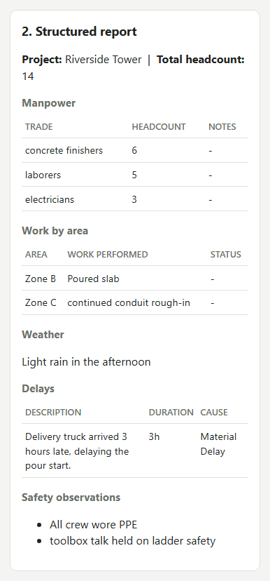

# Daily Field Report Pipeline

Rough field notes and phone photos in, a reviewed, branded Daily Field Report PDF out —
built on [SuperDocs](https://superdocs.app) for the upload → AI edit → human approval →
export loop.

**Who it's for:** a construction superintendent or field engineer, phone-first. They
dictate or type what happened on site today, snap a few photos, and get back a
structured report they can review and approve without touching a desktop.

Built for the SuperDocs Full-Stack AI Engineer take-home task (Task 2 — assigned build:
*Daily field report pipeline*).

---

## What it does

```
rough notes + photos
        |
        v
structured extraction (manpower, equipment, work by area,
weather, delays + causes, safety observations)
        |
        v
photo analysis -> captions + relevance flags
        |
        v
branded HTML report
        |
        v
SuperDocs: upload -> AI edit -> awaiting human approval
        |
        v
human reviews proposed changes in the phone-first UI
        |
        v
approve -> SuperDocs export -> PDF ready to download
```

On top of the per-report loop above, two things operate **across** reports:

- **Nightly batch** — catches any report that never made it out of intake (a dropped
  connection, a crashed request) and reprocesses it, in isolation from every other
  report, idempotently.
- **Weekly rollup** — aggregates a project's reports for a date range into a progress
  summary and a list of *recurring* delay causes, with every claim linked back to the
  specific report(s) that support it.

## Accepted inputs / domain

- **Notes**: free-text field notes, any length, in the textarea. Optional if photos are
  provided.
- **Photos**: JPEG, PNG, or WebP, up to 10 photos per report, 10 MB each. Optional if
  notes are provided. At least one of notes or photos is required.
- **Project**: optional free-text field. If omitted, the system tries to extract a
  project name from the notes instead (useful for photos-only reports, which have
  nothing to extract from).
- **Domain**: construction daily field reporting specifically — the extraction prompt is
  tuned to reject inventing construction context for unrelated photos (tested against a
  non-construction image) and to only extract facts explicitly stated in the notes.

A second run with different notes/photos, inside this same declared set, works the same
way — nothing here is a one-off demo path.

## Architecture

```
frontend/                      Phone-first static page (plain HTML/JS, no build step)
  index.html, style.css, app.js
        |  fetch()
        v
backend/app/
  main.py                      FastAPI app; mounts routers + serves frontend/ as static files
  routers/
    reports.py                 POST /api/v1/reports, POST /{id}/approve, GET /{id}/download
    batch.py                   POST /api/v1/batch/run
    rollups.py                 GET  /api/v1/rollups/weekly
  services/
    report_intake.py           Saves notes/photos to disk, initial metadata.json
    report_extractor.py        SuperDocs chat() -> structured JSON -> FieldReportData
    report_pipeline.py         Orchestrates extraction -> captions -> HTML -> SuperDocs
    report_builder.py          Builds the branded HTML report (escapes everything)
    report_store.py            Shared, atomic metadata.json / report.json read-write
    superdocs_service.py       The four SuperDocs calls: upload, chat, approve, export
    nightly_batch.py           Idempotent catch-up processing for pending reports
    weekly_rollup.py           Pure aggregation over report.json files -> grounded rollup
  models/field_report.py       FieldReportData, closed cause_category vocabulary
storage/                       reports/{id}/, batches/{date}.json, exports/, rollups/
```

**Storage** is plain files on disk — no database, no queue, no cron daemon. Each report
gets a directory (`storage/reports/{report_id}/`) holding its notes, photos,
`metadata.json` (the queryable index: status, project, report_date), and
`report.json` (the full structured extraction, written independently of whether
SuperDocs later succeeds). This was a deliberate choice for the assigned scope — see
[PROGRESS.md](./PROGRESS.md) for the full reasoning.

**Report status lifecycle**: `pending -> processing -> awaiting_approval -> approved ->
exported`, with `failed` reachable from any step that goes wrong (SuperDocs failure,
extraction validation failure, etc.) — a report is never left looking like it's still in
flight after it actually died.

## SuperDocs features used

Built on the SuperDocs REST API (not MCP): document upload, chat-based AI editing
(async, with human-in-the-loop approval), and export. All four API calls below are
exercised on every report that goes through the full loop.

## The four SuperDocs calls

| Step | Endpoint | Where |
|---|---|---|
| Upload | `POST /v1/documents/upload` | `superdocs_service.upload_document()` |
| AI edit | `POST /v1/chat/async` | `superdocs_service.start_approval_job()` |
| Approve | `POST /v1/chat/{session_id}/approve` | `superdocs_service.approve_changes()` |
| Export | `POST /v1/documents/export` | `superdocs_service.export_document()` |

`export_document()` reads the response as binary (`response.content`), not JSON —
the export endpoint returns the actual document bytes, not a JSON wrapper.

## Setup / run

Requires Python 3.11+ and a SuperDocs API key ([docs.superdocs.app](https://docs.superdocs.app)).

```bash
cd backend
pip install -r requirements.txt
```

Create `backend/.env`:

```
SUPERDOCS_API_KEY=your_key_here
SUPERDOCS_BASE_URL=https://api.superdocs.app
```

Run the app:

```bash
cd backend
python -m uvicorn app.main:app --port 8000
```

Open `http://127.0.0.1:8000/` — that's the phone-first UI, served by the same FastAPI
app (no separate frontend server, no build step).

Run the nightly batch on demand instead of waiting for a real night:

```bash
python -m app.services.nightly_batch
# or: POST /api/v1/batch/run
```

Run a weekly rollup:

```
GET /api/v1/rollups/weekly?project=Riverside+Tower&start_date=2026-08-10&end_date=2026-08-16
```

### Tests

```bash
cd backend
pytest
```

18 tests, no `SUPERDOCS_API_KEY` required — this was verified by removing `.env`
entirely and re-running. They cover the pure-logic pieces: `cause_category`
normalization, `safety_observations` malformed-shape coercion, nightly batch
idempotency/failure-isolation, and weekly rollup grounding/recurrence detection.

The `test_superdocs_*.py` and `test_report_*.py` scripts alongside them are separate,
honest manual/live-API scripts (not pytest, no mocks, cost real SuperDocs operations,
need a real key) — left as-is, not touched.

## What "strong" looks like here, and how it's addressed

The assigned build calls out three specific bars:

- **"Photo captions are specific and useful rather than generic"** — the vision prompt
  asks for concise, professional captions describing only what's visibly present, and
  explicitly rejects inventing project impact, causes, or context it can't see. Tested
  against both a real construction photo and a clearly unrelated image (confirmed it
  states non-relevance rather than hallucinating construction context).
- **"Delay causes are categorized consistently enough to roll up meaningfully"** —
  `cause_category` is a closed 8-value vocabulary
  (`weather`, `equipment_failure`, `material_delay`, `labor_shortage`,
  `permitting_inspection`, `design_coordination`, `site_conditions`, `other`), not free
  text. Writing the offline test suite caught a real bug here: the synonym-mapping
  safety net didn't recognize the canonical underscore-form values themselves, so every
  *correctly*-formatted model response was silently downgraded to `other`. Fixed and
  covered by a regression test.
- **"The nightly batch is resilient to partial input and never emits a half-empty
  report silently"** — each report in a batch run is processed independently; one
  report's failure is caught, recorded with a reason, and does not stop the rest.
  Nothing that fails partway is left looking complete — it's marked `failed` with why.

## Assumptions and decisions

Pulled from the full working log in [PROGRESS.md](./PROGRESS.md); the key ones:

- **Explicit vs. extracted project conflicts aren't silently resolved.** If a
  submission-time project name and the notes-extracted project name disagree, the
  explicit one is used for the index, but the disagreement is recorded in
  `metadata.project_mismatch` rather than dropped.
- **Intake stays synchronous.** `POST /api/v1/reports` still does the full
  extraction→SuperDocs pipeline inside the request (better phone UX, immediate
  feedback). The nightly batch is catch-up for anything that never completed — not the
  primary path.
- **"Recurring" means 2+ distinct reports**, not 2+ delay entries within one report. A
  week with 0 or 1 matching report never claims a recurring cause — it says so
  explicitly instead of returning a silent empty list.
- **The weekly rollup is pure aggregation, not an LLM summary.** Every line traces
  directly to fields already extracted and validated per-report. There's nothing to
  hallucinate because nothing is generated.
- **Batch summaries are one file per calendar day**, overwritten by each run that day
  (not accumulated) — kept simple deliberately; revisit if per-run history ever matters.
- **Cause-category normalization uses a hand-picked synonym map** as a safety net; the
  extraction prompt is the primary mechanism, asking the model to emit one of the eight
  closed values directly.

## Known limitations

- **A hard process crash mid-processing** (not a caught exception — the process itself
  dying) leaves that report's metadata stuck in `processing` with no automatic recovery.
  Acceptable at this scope for a file-based system, but a real limitation, not a silent
  gap.
- **Cause-category accuracy depends on model compliance.** The synonym map is a safety
  net, not a guarantee — an unrecognized phrasing still correctly falls back to `other`
  rather than guessing, but that means some legitimately-categorizable delays may land
  in `other` if the model's wording doesn't match a known synonym.
- **The weekly rollup pushing through SuperDocs' edit/approve/export loop was left out**
  — the task explicitly frames this as optional depth; aggregation and grounding
  correctness came first under the deadline.
- **SuperDocs' first request in a fresh session can be slow or fail while things warm
  up** (documented SuperDocs behavior, not a bug in this build) — encountered once
  during live testing; a retry with identical input succeeded.

## Screenshot

The structured report view, rendered from a real submission (notes only, no photos) run
against the live app on `main`:



Note the `Material Delay` cause category on "Delivery truck arrived 3 hours late" — this
confirms the closed-vocabulary categorization (see "What strong looks like" above) is
working correctly end-to-end, not just in the offline tests.
