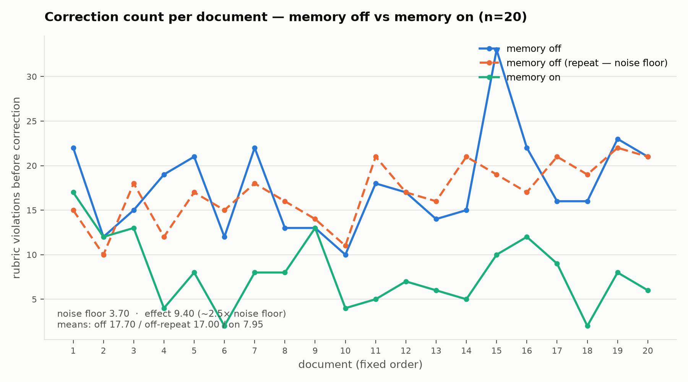

# House-style memory agent

Built for the SuperDocs Round 2 task.

An agent that edits documents through SuperDocs and, with the operator's
consent, keeps a durable per-customer note of the corrections it received —
preferences accepted, phrasings rejected, formatting conventions. Over a
series of sessions it needs fewer corrections on the same class of document.

**The deliverable is not the agent. The deliverable is a measured curve:**
correction count per document across twenty documents, memory off versus
memory on, with the control arm run properly. Everything below is in service
of that curve being real, not asserted.

*This PR's commit history is a single squashed commit rather than the
project's full development history — the same no-email rail this build
applied to every other artefact meant the original per-commit author metadata
(a personal email address) could not go into a public repository, so the
history was squashed to remove it before this went up.*

## The measurement

House style is an explicit, committed rubric — 14 concrete rules for a
fictional agency, "Meridian" (`rubrics/meridian.json`) — not something inferred
by feel. 13 of the 14 rules are deterministic (regex or a committed procedure,
no model call); one (active voice) is scored by a fixed, committed prompt run
through Gemini at temperature 0. A correction count for a document is the
number of rubric violations in the agent's own edit, counted by an automated
checker that is a **separate codebase from the editing agent** and is never
told which arm produced the document it's scoring.

The correction protocol is **scripted, not improvised**: a deterministic
function turns each rubric violation into a canned, templated message quoting
the offending text. The same document produces byte-identical corrections
regardless of which arm produced it — verified over 50 repeated runs per
document, 20 documents, zero variation. This is the design's load-bearing
constraint: a human improvising corrections gets better at correcting as they
go, and that improvement would silently land in whichever arm ran second.

Both arms saw the same 20 documents, in the same fixed order, with the same
correction protocol. The only difference was `cross_session_memory` on or
off. Twenty documents were generated fresh via Gemini, then deterministically
normalized to zero rubric violations and injected with an identical
24-violation profile per document — difficulty is uniform by construction and
verified by test, not assumed.

## The result



| | mean | sd |
|---|---|---|
| memory off | 17.70 | 5.22 |
| memory off (repeat — noise floor) | 17.00 | 3.38 |
| memory on | 7.95 | 3.87 |

**Noise floor: 3.70** — the memory-off arm run twice, independently, to
measure how much the curve moves with memory held constant at "off." **Effect:
9.40**, roughly **2.5× the noise floor**. 17 of 20 documents scored below
*both* memory-off runs, not just one. Raw per-document data for all three
arms: [`runs/n20_main/results.json`](runs/n20_main/results.json).

This measures rubric adherence — a proxy for what a human editor would flag —
not editorial quality itself, stated plainly rather than implied.

## Scoping and leakage — proven by a test

Memory is opt-in and scoped per end customer via `cross_session_memory_key`,
confirmed against the live tool schema (*"kept in a separate file per
end-customer"*) and a live probe: a preference taught under one key was
recalled under that key and absent under a different one.
`cross_session_search` is deliberately never enabled anywhere in this build —
per the schema it can search and open documents from *other* sessions
account-wide, and `cross_session_scope` narrows only by session ID within the
same API key, not by customer, so turning search on would have been a leak
vector rather than a leak defence.

The leak test: two deliberately opposed fictional clients — Northwind
(compliance-formal, third person, day-first dates, no contractions) and Ember
(consumer-app, second person, US dates, contractions required) — share no
mutually-satisfiable convention across 11 axes. Each ran 5 documents,
memory-on, scoped by its own key. Every final document was then scanned for
the *other* client's strongest, least-ambiguous markers (day-first long
dates, third/second-person address, currency form, citation form).

**Result: zero cross-client marker hits, net of seed baseline, in both
directions**, across 10 documents.
[`runs/leak_test/results.json`](runs/leak_test/results.json). One raw hit
existed before adjustment — a single residual date in Ember's output — and
was traced to the seed document already containing two such dates before any
edit; Ember's own correction reduced it, which is imperfect self-correction,
not a leak. The net-of-baseline correction exists because the seed prose
(generated under Meridian's own conventions) already carried day-first dates
and second-person address, which happen to coincide with what the fingerprint
scan checks for — found and corrected for before any live scoring, not
discovered after.

**Rigor caveat, stated here because this is the one result the brief calls out
as needing to be "proven":** the Northwind/Ember detectors (5 of 12 rules per
client are new logic; 7 reuse Meridian's already-tested functions directly)
were validated by a 51-case self-check against each rule's own committed
examples — **not** the fixture-plus-mutation-testing pass every other detector
in this project received. That is a real, disclosed reduction in rigor,
accepted under this session's time constraint. See "What's not included"
below.

## The wipe

`clear_cross_session_memory` returned `{removed: N}` — first tested with a
freshly-probed key that turned out not to establish a clean before/after
learning signal to demonstrate reversion against (an honest null,
[`runs/wipe_test/results.json`](runs/wipe_test/results.json)). A follow-up
reused the key that had *already* proven a real, measured effect — the memory-on
arm above — wiped it, and ran one further document through the identical
protocol:

| | doc_18 score |
|---|---|
| memory off | 16 |
| memory off (repeat) | 19 |
| memory on, before wipe | 2 |
| memory on, **after** wipe | **12** |

The wipe removed exactly one entry — a single consolidated note per
end-customer, not a growing per-interaction log, which is itself evidence the
bounded-note design is real rather than asserted. The post-wipe score sits
decisively on the memory-off side of the gap, not near the trained level.
Full detail: [`runs/wipe_test_v2/results.json`](runs/wipe_test_v2/results.json).

## What's not included

- **Full mutation-testing on the Northwind/Ember detectors.** Every Meridian
  detector was validated with hand-computed fixtures *and* a mutation-testing
  pass (deliberate defects injected, suite must fail on each) before being
  trusted on live text — the client detectors got the faster fixture-only
  check described above, a disclosed trade-off under time pressure.
- **A live memory-off noise-floor pass on the leak-test corpus specifically.**
  The main curve's noise floor is a live repeated run; the leak test's
  seed-baseline subtraction is a static, one-time substitute for the same
  idea, not the same strength of evidence.
- Editorial quality itself — this measures rubric adherence, a countable
  proxy, not a human editor's judgment.

## SuperDocs features used

- `chat` (synchronous, `approval_mode: approve_all`) — the agent's edit and
  the correction round, both driven through this one tool
- `chat_async` + `get_job` + `approve_change` — the explicit per-change
  approval flow, exercised and tested, not on the measurement's hot path
  (see `PROGRESS.md` for why: no billing telemetry on that path, and observed
  no-op proposed changes in testing)
- `cross_session_memory` + `cross_session_memory_key` — the durable,
  per-end-customer note this whole build measures
- `clear_cross_session_memory` — the wipe
- `init_session`, `upload_document_base64`, `export_document` — session and
  document lifecycle
- MCP over the streamable-HTTP binding (`initialize` → `tools/call`), not the
  REST API directly

## Try it

```bash
python3 -m venv .venv && .venv/bin/pip install -r requirements.txt  # pytest, certifi
PYTHONPATH=. .venv/bin/python -m pytest tests/ -q   # 225 tests, no key required
```

A live run needs a `.env` file (gitignored) with:

```
SUPERDOCS_SK=your-superdocs-key-here
GEMINI_API_KEY=your-gemini-key-here
```

Then: `runner/experiment.py` (the main memory-off/memory-on run),
`runner/leak_test.py` (the cross-customer isolation test), and
`runner/wipe_test.py` (the wipe) are the entry points — each takes `--n` for a
small dev sample before committing to a full run. `PROGRESS.md` is the full,
dated log of every assumption, decision, cut, and real run this build made,
including the ones that didn't go as planned.

All clients, corpus documents, and test data are fictional, per the task's
rails. No real third-party or employer material was used.
