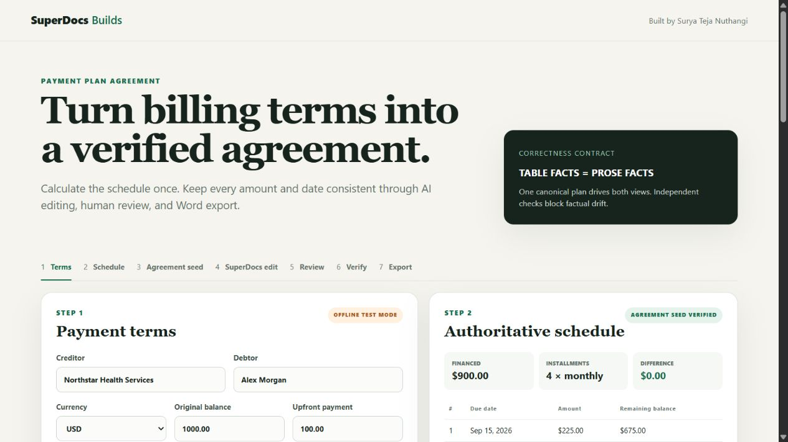

# Payment Plan Agreement

Built by **Surya Teja Nuthangi** for the SuperDocs community builds repository.

This use case turns structured billing terms into a plain-language payment-plan agreement. A deterministic engine calculates the authoritative schedule, renders both its table and prose from one canonical plan, and independently verifies protected facts before and after SuperDocs editing.



## Who it serves

Small-business and healthcare-style billing workflows that need clear installment agreements. All bundled examples use synthetic data.

## Correctness property

`TABLE FACTS == PROSE FACTS == CANONICAL PAYMENT PLAN`

SuperDocs is asked only to improve clarity and organization. It never calculates balances, installments, or dates. Proposed edits remain behind an item-level human approval gate, and protected-fact changes cannot be approved.

## Features

- Structured terms form and deterministic schedule preview before any external operation
- Async SuperDocs editing with bounded polling and per-change approve/reject controls
- Pre-approval and final independent verification
- Real DOCX export in live mode
- Clearly labeled deterministic offline mode for evaluation and tests

## Setup

Python 3.11 or newer is required.

```powershell
python -m venv .venv
.\.venv\Scripts\python.exe -m pip install -e ".[dev]"
.\.venv\Scripts\python.exe app.py
```

Open `http://127.0.0.1:8000`. On macOS/Linux, use `./.venv/bin/python`.

## Modes and SuperDocs integration

Offline demo mode is the default, requires no credentials, and labels itself `OFFLINE TEST MODE`. For live use, set the key only in the server environment and restart:

```powershell
$env:SUPERDOCS_API_KEY = "your-key-here"
.\.venv\Scripts\python.exe app.py
```

The browser never receives the key. Live mode uses `POST /v1/chat/async`, bounded `GET /v1/jobs/{job_id}` polling, item decisions at `POST /v1/chat/{session_id}/approve`, final polling and verification, then `POST /v1/documents/export`.

Run the single synthetic live smoke path with:

```powershell
.\.venv\Scripts\python.exe scripts\live_smoke.py
```

Successful live artifacts are written under `artifacts/live/` and git-ignored.

### Live verification evidence

The synthetic end-to-end path was verified on 2026-08-15: one async edit job, durable polling, 14 item-level proposals, 14 approvals, zero rejections, zero repairs, independent final verification with zero findings, and a valid 37,329-byte DOCX export. During verification, the adapter was hardened for nullable proposal arrays, multi-batch approval, stale post-approval status, and SuperDocs-normalized chunk markers.

## Tests

```powershell
.\.venv\Scripts\python.exe -m pytest
```

Final regression on Python 3.14.6: **36 passed in 1.06s**. The suite covers arithmetic, rounding, dates, projections, verifier failures, malformed proposals, missing-key failure before network access, timeout state preservation, repeated decisions, multiple proposal batches, normalized HTML, item review, current approval/export payloads, and export-failure preservation.

## Environment variables

| Variable | Required | Purpose |
|---|---:|---|
| `SUPERDOCS_API_KEY` | Live only | Server-side API authentication |
| `SUPERDOCS_BASE_URL` | No | API base override for controlled testing |
| `PORT` | No | Local server port; defaults to `8000` |

## Limitations

- This is not legal advice and includes no native e-signature.
- Cadence is bounded to weekly, biweekly, and monthly in v1.
- Local demo state is in memory; SuperDocs jobs remain durable by job ID.
- Live editing and export require a valid server-side key; the bundled evidence uses only synthetic data and excludes credentials and document payloads.
- Offline mode is development/evaluation infrastructure and is always labeled.
