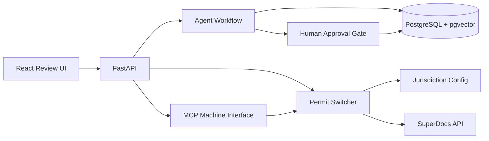

# Architecture

## Task 1 flow

`ingest -> extract -> reconcile -> compliance -> plan_update -> review -> commit`

The run state is persisted after each meaningful stage so the process can be resumed. Conflicts and compliance findings stop at review rather than being silently committed.

## Task 2 flow

`project record + master narrative + jurisdiction config -> packet HTML -> SuperDocs server-side edit -> final packet + gaps + checklist`

The jurisdiction configuration is the source of differences. The generator does not branch on individual jurisdictions in application code.
