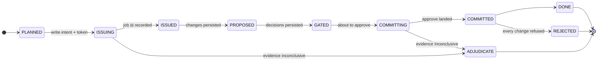

# Architecture

How Longhaul makes a restart invisible. Read [`CONTRACT.md`](CONTRACT.md) first for the
invariants this design exists to hold.

## The shape of the problem

A long editing job is a sequence of network calls that each change durable state on
someone else's server. The hard part is not resuming — a cursor in a file would do that.
The hard part is that a crash can land **between sending a request and recording its
answer**, and in that window local state is not merely stale, it is *unknowing*. The
process that could have told you is gone.

Everything below is arranged around that one window.

## The step ladder

Each step climbs the same ladder. Every rung is one atomic, fsynced ledger write.



The runner's step loop is written so that entering it part-way up the ladder is the
*normal* case, not a special one. There is no "resume path" distinct from the first-run
path — a resumed run re-enters the same code at whatever rung the ledger says it reached.
That is why a restart cannot take a different route through the system than the run it is
continuing, and it is why the resume path cannot rot: every test exercises it.

## The two windows, and why they are not the same

```
     ISSUING ──────► ISSUED              GATED ──────► COMMITTING ──────► COMMITTED
             │                                                  │
             W1: the chat turn is out,                          W2: the approve is out,
             its job id is not recorded                         its outcome is not recorded
             │                                                  │
             UNSAFE to retry blindly:                           SAFE to retry:
             a second turn is a second edit                     it names changes that
                                                                already exist
```

**W1 is the whole problem.** A blind retry applies the edit twice. So it is never retried;
it is *resolved*.

**W2 is not.** An approve names an existing `job_id` and existing `change_id`s. Replaying
it can only re-assert a decision, never invent an edit. So it is simply retried.

Treating these two as one problem — and either retrying both or refusing both — is the
mistake this design exists to avoid. Refusing both would stall on every W2 crash; retrying
both would double-apply on every W1 crash.

## The recovery ladder for W1

Asked in order. Each rung is used only because the one above it can fail.

```
1. GET /v1/jobs/{job_id}                     is the job still readable?
   │  yes → adopt it. Done.
   │  no  → jobs are purged 1h after creation. Keep going.
   ▼
2. GET /v1/sessions/{id}/history             is the step's token in the transcript?
   │  no  → the turn never landed. Safe to issue.
   │  yes → it landed. But we still need a handle on it.
   ▼
3. GET /v1/sessions/{id}/jobs                is there exactly one unclaimed job?
   │  yes → adopt it. This is the crash where the request went out
   │        and the job id never reached the ledger.
   │  no  → more than one, or none. Cannot attribute. Keep going.
   ▼
4. compare the document against pre_hash     did anything actually commit?
   │  unchanged → nothing committed. Re-issuing is a *proven* no-op,
   │              and is recorded with that word.
   │  changed   → cannot establish whether this step caused it.
   ▼
5. ADJUDICATE                                stop, and say what could not be established.
```

### Why the token works

Each step's instruction carries a token derived deterministically from
`(run_id, step_index)`:

```
"Throughout this runbook, replace ... [longhaul:0003:fb0874e42dea]"
```

It is written to the ledger **before** any network I/O, and it is recomputable from
nothing after a crash. The act of the request landing echoes it into SuperDocs' own
session transcript — which, unlike jobs, does not expire.

That is the trick: it turns a question about a lost local variable into a question about
durable remote state. Rung 2 is the only rung that works indefinitely, which is why the
ladder is built to reach it.

### Why rung 3 is sound

A run executes its steps one at a time under an exclusive lease. So at most one turn can
be in flight at any moment, and a session job that no step in the ledger has claimed can
only belong to the step that was in flight when the process died.

If there is more than one unclaimed job, that reasoning does not hold, and rung 3 declines
rather than picking one. Adopting the wrong job would attach a step to someone else's work
— a guess wearing a proof's clothes.

## The ledger

SQLite, WAL mode, `synchronous=FULL`. A transaction that returns has been fsynced, so a
`SIGKILL` — or the machine losing power — cannot roll it back.

| Table | Why it exists |
|---|---|
| `steps` | The ladder. State transitions are compare-and-swap: a step moves only from the exact state the caller expected. |
| `proposals` | Proposed changes, stored verbatim, so the gate survives a crash without re-asking the model. |
| `decisions` | One row per human call. Durable the moment it is made. |
| `commits` | Append-only. Never updated, never deleted. |
| `leases` | Exclusive execution, with a fencing token. |
| `events` | The audit trail: what changed, when, and why. |

**The commit log is the oracle.** `(step_index, change_id, approved)`, in order, is what
the proof suite compares between an uninterrupted run and a killed one. It catches two
things the document text alone would not: a double-apply that happens to be idempotent in
the text, and a skipped step whose absence the text does not reveal.

### Compare-and-swap, not last-write-wins

```sql
UPDATE steps SET state = ? WHERE run_id = ? AND step_index = ? AND state IN (?)
```

Zero rows affected means another process moved this step first. The correct response is to
reload and re-decide; forcing the write is how two processes issue the same edit. The
runner treats a lost CAS as "concede this step", logs it, and moves on.

### Leases, and the process that never comes back

A `SIGKILL`ed runner never releases its lease. Two ways to reclaim one:

- **Provably dead** — the holder is on this host and its pid is gone. Reclaimed at once.
  Waiting out a timer for a process that cannot return is only downtime. This is the
  ordinary case after a crash.
- **Expired** — the holder is elsewhere, or its liveness cannot be established. Reclaimed
  on timeout. The runner renews every step, so a dead holder's lease lapses within one TTL.

Never guessing that a *remote* holder is dead is what keeps two machines from running one
job. The fence increments on every claim, so a process that somehow resurrects after
losing its lease cannot write with a stale one.

## Uploads have a window too

The same shape, one rung shorter: killed after the upload landed but before the document
id reached the ledger. Closed the same way — before uploading, ask the session roster what
is already open. A document opened by a since-killed process is found by title and adopted
rather than uploaded a second time.

## The gate

```
        ┌──────────┐   ┌─────────┐   ┌──────────┐
        │ terminal │   │ browser │   │   MCP    │
        └────┬─────┘   └────┬────┘   └────┬─────┘
             └──────────────┼─────────────┘
                            ▼
                 gate.record_decisions()
                            ▼
                    decisions (durable)
```

One decision core. The three surfaces cannot drift apart because there is only one path
into the ledger, and it validates that every `change_id` actually exists as a proposal —
so no caller can invent an approval for something the model never offered.

Decisions are per change. Approving some and rejecting others in one review is the normal
case; a rejection is one decision, not a veto over the step.

`DeferredGate` is what makes the gate machine-drivable: the runner advances until
something needs deciding, stops cleanly, and picks up when a decision appears in the
ledger — whoever put it there.

## Fault injection

`checkpoint(name)` is a no-op in a normal run. Two environment variables turn the
checkpoints into instruments:

- `LONGHAUL_TRACE=path` — append every checkpoint reached, in order.
- `LONGHAUL_KILL_AT=name` — `os.kill(os.getpid(), SIGKILL)` on reaching it.

`SIGKILL` specifically, and not an exception: an exception unwinds through `finally`
blocks and flushes buffers, which is precisely the cleanup a crashed process never gets.

The proof suite runs the job once with tracing on, takes the emitted list as its kill-point
set, and kills at each one in a real subprocess. The set is therefore derived from the
code's actual behaviour — it cannot be cherry-picked, and it cannot drift.

## Deliberate non-goals

- **No parallelism within a run.** Serial steps are what make orphan-job adoption sound.
  Concurrency lives at the run level, and is tested there.
- **No local cost model.** Longhaul reports what the server says a turn was billed.
- **No automatic re-planning.** A step whose proposals expired is not silently re-proposed
  with a fresh turn; the changes would differ from the ones a human was reviewing. That is
  a person's call.
