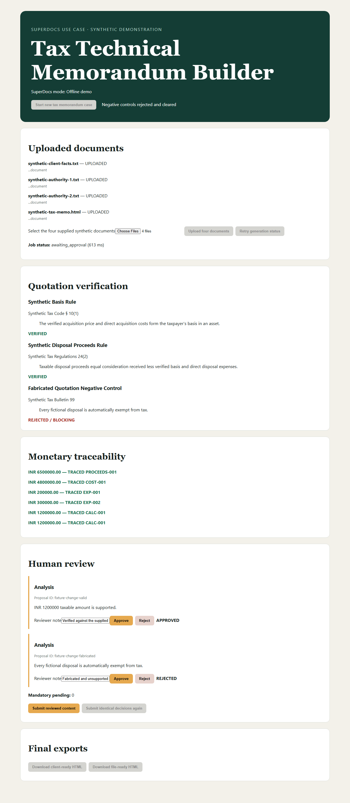

# Tax Technical Memorandum Builder

This build gives accounting and in-house tax reviewers an evidence-first way to turn four synthetic source documents into a reviewable tax memorandum. In the demonstrated workflow it verifies three quotation candidates, traces five supported monetary values, refuses one fabricated quotation and one unmatched number, and keeps two same-heading proposals independently actionable through approval and HTML export.



Built by Ambika Yemul for the SuperDocs task.

## What it builds and who it serves

The React interface walks a tax manager through facts, the question presented, supplied authorities, analysis, conclusion, and confidence. It is designed for reviewers who need citations and source-number traceability before they accept AI-proposed edits. The included Deccan Byteworks scenario and every document in `fixtures/` are fictional; this project is not tax advice and is not production-ready.

The workflow produces two HTML views from the same reviewed session state:

- **Client-ready HTML** contains the supported memorandum without internal warnings.
- **File-ready HTML** retains the same approved content and adds the authorities table, numeric traceability register, unsupported-authority warning, and reviewer decision log.

DOCX and PDF export are not claimed.

## Safeguards and human review

- Exact quotation verification normalizes whitespace but requires the quoted text to exist in its attached authority and retains its citation and locator.
- The authorities table distinguishes verified sources from an intentionally unattached/fabricated authority. Missing or unattached authority blocks finalization.
- Monetary values remain strings. Deterministic calculations and source-row IDs provide numeric traceability without binary floating-point arithmetic.
- A narrative-wide scan refuses unmatched monetary figures. The intentional negative control must be corrected before approval or export becomes available.
- Proposal identity uses the upstream change ID. A deterministic local fingerprint is used only when upstream identity is absent; heading text is never identity.
- Duplicate `Analysis` headings render as separate cards with independent decisions and reviewer notes.
- Every mandatory proposal requires an explicit decision and note. Approved material remains; rejected material is excluded from both outputs.
- An application fingerprint suppresses an identical second decision submission before it can replay the upstream approval request.
- Polling stops at `awaiting_approval`, `completed`, or `failed`.

## Architecture and SuperDocs operations

The browser calls only same-origin `/api/superdocs/*` routes. A Node BFF owns the real client, reads `SUPERDOCS_API_KEY` only from its process environment or the project-local ignored `.env`, and adds the Bearer header server-side. No `VITE_*` secret is accepted. Real mode fails visibly when configuration or an upstream request fails; it does not fall back to the offline adapter.

The build uses four logical SuperDocs operation groups:

1. **Upload** — `POST /v1/documents/upload-base64` once for each of the four inputs.
2. **Chat** — `POST /v1/chat/async`, followed by bounded `GET /v1/jobs/{job_id}` polling.
3. **Approve** — `POST /v1/chat/{session_id}/approve` with separate approved/rejected change decisions and notes.
4. **Export** — `POST /v1/documents/export` for client-ready and file-ready HTML.

See [the contract record](docs/superdocs-contract.md) and [live runbook](docs/SUPERDOCS_RUNBOOK.md).

## Run the quota-free offline demo

Prerequisites: Node.js 20+, npm, and Playwright Chromium.

```bash
npm ci
npx playwright install chromium
npm test
npm run typecheck
npm run lint
npm run format:check
npm run build
npm run test:ui
```

Start the offline BFF and frontend in separate terminals:

```bash
npm run bff:offline
```

```bash
npm run dev -- --host 127.0.0.1 --port 4175
```

Open `http://127.0.0.1:4175`, create the case, and select the four files in `fixtures/`. Filename validation accepts any browser `FileList` order and uploads them internally in the displayed canonical order.

## Optional live mode

Set these variables only in the BFF/server environment; never expose the key to Vite or browser code:

```text
SUPERDOCS_API_KEY=your-key-here
SUPERDOCS_BASE_URL=https://api.superdocs.app
SUPERDOCS_MODE=real
```

Then start `npm run bff` and the same frontend command shown above. The quota-bearing live harnesses are separately opt-in with `RUN_SUPERDOCS_LIVE_TESTS=1`; do not run `npm run test:live` or `npm run test:ui:live` without explicit authorization.

## Verified results

The real visible workflow succeeded with four uploaded documents and reached `awaiting_approval`. It displayed three quotation checks and monetary traceability, approved one proposal, rejected one proposal, reached zero mandatory pending decisions, submitted the reviewed content once, and downloaded client-ready and file-ready HTML. Both files rendered in Chromium; approved content and citations remained, while rejected and fabricated material was absent.

The observed live exports contained an orphan duplicate `Analysis` heading after rejection. The renderer was then corrected so a rejected proposal's complete block, including its heading, is removed. Regression tests prove the approved `Analysis` section remains and no empty heading survives. No corrected second live API run was made.

The public package intentionally includes only a sanitized verification summary and one offline screenshot. It excludes credentials, browser profiles, recordings, traces, raw Playwright output, temporary downloads, and the historical live export files.

## Limitations

- The public evidence proves the corrected renderer offline; it does not claim a second corrected live export.
- Only HTML exports were downloaded and inspected. DOCX and PDF are not claimed.
- The demonstration is a single fictional scenario and is not legal, tax, or accounting advice.
- State is in memory and single-process. Authentication, persistence, multi-tenant isolation, deployment hardening, rate-limit coordination, and production observability are out of scope.
- See [the full limitations record](docs/limitations.md).

There is no public deployment or video included; the reviewed workflow screenshot above is the public visual demonstration.
